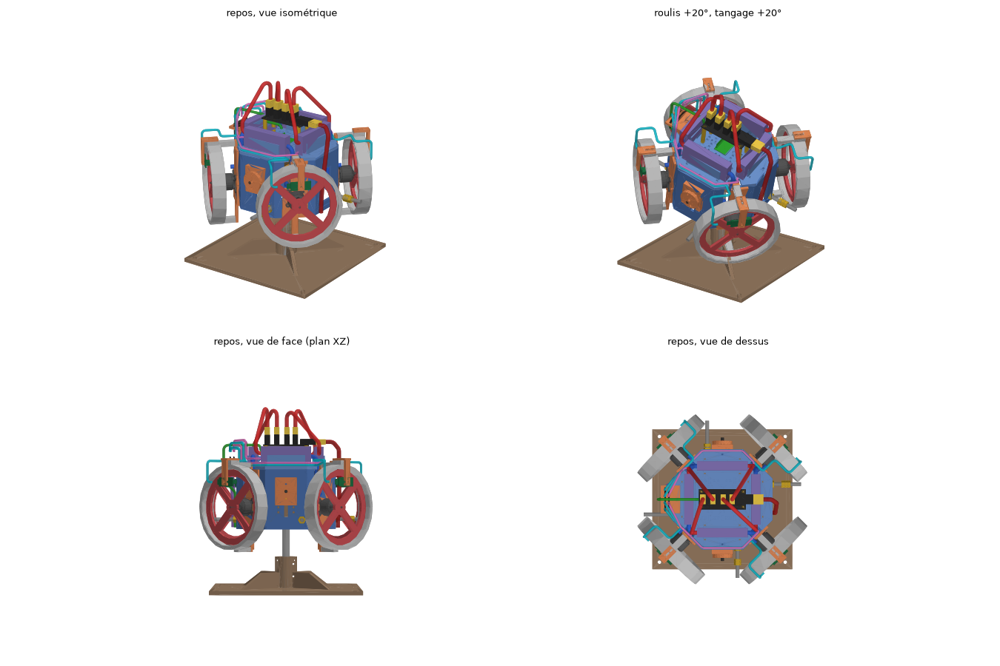
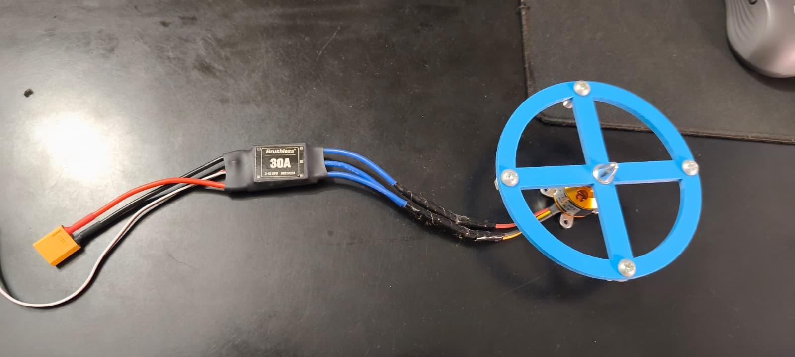
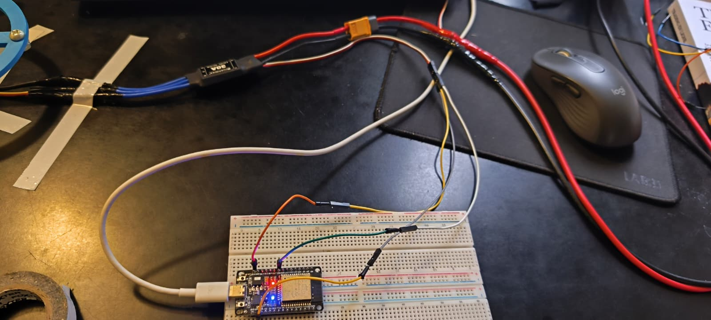
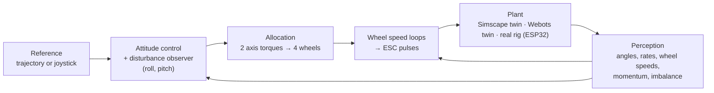
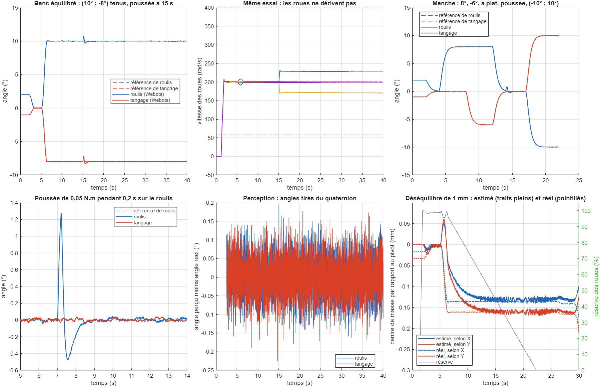

# Reaction-wheel stabilisation of a self-balancing monowheel robot

**Crystof** is the mascot robot of the CRYSTEO student association (JUNIA, Lille, France): a robot that balances on a single wheel. This repository documents the subsystem I designed to keep it upright: **four reaction wheels at 45°, an ESP32, a BNO055 IMU and a two-axis attitude controller**, from the first hand calculations to a two-axis test rig, its digital twin and the embedded firmware.

<p align="center">
  
</p>
<p align="center">
  
  &nbsp;
  
</p>

| | |
| --- | --- |
| **My role** | Stabilisation subsystem: sizing, architecture, system model, CAD, control design, simulation, firmware and test tooling |
| **Context** | Student association project (CRYSTEO, JUNIA), October 2025 to today, alongside my engineering degree |
| **Tools** | MATLAB/Simulink, Simscape Multibody, Webots · C++ on ESP32 (PlatformIO, FreeRTOS) · SolidWorks and its API, Python (build123d, NumPy) · Capella (Arcadia MBSE) |
| **Status** | Two-axis test rig designed and verified in CAD; full control stack validated on two digital twins; Simulink drives the real motor through the ESP32. Next: build the rig ([plan](#status-and-next-steps)) |

## Where to look first

| If you want to see… | Open |
| --- | --- |
| The test rig, its design and its checks (41-page technical file, in French) | [Technical documentation (PDF)](cad/solidworks/banc-stabilisation/Documentation-technique_banc-stabilisation.pdf) |
| The control stack running on a digital twin | [simulation/jumeau-numerique](simulation/jumeau-numerique/README.md) |
| CAD written as code, rebuilt in SolidWorks with an automatic mate solver | [cad/solidworks/banc-stabilisation/sources](cad/solidworks/banc-stabilisation/sources) |
| Hardware-in-the-loop: Simulink in real time driving the motor through an ESP32 | [control/banc-moteur](control/banc-moteur/README.md) |
| Embedded C++: IMU driver, ESC driver, PID, FreeRTOS | [firmware](firmware/README.md) |
| The engineering reasoning: sizing, architecture, torque review | [docs](docs/README.md) |

## Highlights

- **A digital twin with the same interface as the real rig.** One Simulink model controls two interchangeable plants: a Simscape Multibody twin and a Webots twin, the latter driven over TCP with exactly the frames the ESP32 will exchange. Swapping in the real rig only changes the plant block. [Digital twin](simulation/jumeau-numerique/README.md)
- **A complete control stack.** Reference (polynomial trajectories or a drone-like joystick), attitude control with a disturbance observer on each axis, allocation of the two axis torques to four wheels, wheel speed loops, and a perception layer (gimbal angles from the quaternion, signed wheel speeds, angular momentum, external torque, centre-of-mass offset in mm). On both twins: a (10°, −8°) attitude held within 0.05°, a 0.05 N·m push rejected in 0.3 s, the twins agreeing within 0.07°.
- **CAD as code.** The whole rig (about 40 parts, and every cable at its measured length and diameter) comes from one parameter file. It is checked in Python for interferences, including a sweep of the gimbal over ±20° on both axes at 8 pivot heights, then rebuilt in SolidWorks through its API. A small solver picks the minimal set of mates from the geometry (rank of the constraint Jacobian): 168 mates, 0 errors, one fixed part per assembly. [Sources](cad/solidworks/banc-stabilisation/sources)
- **Static balancing by design.** Slotted bearings set the pitch axis height, and four M6 rods carry adjustment nuts. The nut positions and pivot height are computed so that the centre of mass sits on the pivot, and every clearance is checked over the full adjustment range. [Rig README](cad/solidworks/banc-stabilisation/README.md)
- **Hardware-in-the-loop motor bench.** Simulink runs the controller in real time and sends a framed, checksummed command to the ESP32 every 10 ms; the ESP32 drives the ESC, with arming, failsafe and telemetry. [Motor bench](control/banc-moteur/README.md)
- **Sizing from first principles.** Correcting a 10° tilt in 0.4 s on a 6.5 kg, 50 cm robot needs 3.3 N·m, i.e. 1.17 N·m and about 20 A per wheel. [Sizing](docs/02-dimensionnement.md)
- **An engineering review that changed the plan.** Before any test, the torque budget showed that the motor bought (A2212) delivers **6 to 12 times less torque** than the final robot needs. The project was re-scoped to a test rig that validates the control chain with this motor. [Torque review](docs/04-revue-budget-de-couple.md)
- **Modular embedded firmware and a system model.** BNO055 I2C driver, ESC driver with arming and failsafe, two-axis PID with 45° allocation at 200 Hz on FreeRTOS; a Capella model of the whole robot. [Firmware](firmware/README.md), [Capella](capella/README.md)

## How it works



Accelerating a flywheel one way pushes the body the other way. The controller reads the tilt, computes the roll and pitch torques that bring the body to the requested attitude, splits them across the four wheels, and each wheel loop turns its torque into a speed command for its ESC.

<p align="center">
  
</p>

## Key figures

| Quantity | Value |
| --- | --- |
| Final robot: mass, height | 6.5 kg, 50 cm |
| Torque needed to correct 10° in 0.4 s | 3.3 N·m total, 1.17 N·m per wheel |
| Test rig: moving mass, tilt range | 1.29 kg, ±20° on roll and pitch |
| Test rig: actuators and sensors | 4 × A2212 1400 KV with 120 mm flywheels, 4 × 30 A ESC, BNO055, 4 TCRT5000 speed sensors |
| Centre of mass after balancing (model) | 0.00 mm and 0.06 mm from the pitch and roll axes |
| Attitude held on the twins | within 0.05° at (10°, −8°) |
| Push of 0.05 N·m | back within 0.5° in 0.3 s |
| Rig purchases (excluding parts already owned) | ≈ 92 € |

## How the project evolved

Dates below are the original dates of the work.

| When | Milestone | Where |
| --- | --- | --- |
| Oct 2025 | Literature review: Wheelbot, KTH reaction-wheel robot, LQG-controlled monowheel, gyroscopes | [references](docs/references.md) |
| 21 Oct 2025 | First hand calculations: torques, inertias, first motor choice | [scan](docs/sources/2025-10-21_calculs-manuscrits-dimensionnement.pdf) |
| 7–8 Nov 2025 | Sizing note and four-wheel configuration study | [sizing](docs/02-dimensionnement.md), [architecture](docs/03-architecture-4-roues.md) |
| Dec 2025 | Sponsorship file; Capella system model | [sponsorship](docs/sources/2025-12-03_dossier-sponsoring.pdf), [capella/](capella/README.md) |
| Jan 2026 | Reaction-wheel CAD and 3D-printed parts; BNO055 and ESC drivers; Simulink motor tooling | [cad/](cad/README.md), [archive](firmware/archive/README.md), [matlab/](matlab/README.md) |
| Feb 2026 | Stabilisation assembly; modular firmware with PID and 45° allocation | [firmware/](firmware/README.md) |
| Sep 2026 | Engineering review: torque budget, TRL 4 plan, real-time single-axis test | [review](docs/04-revue-budget-de-couple.md), [plan](docs/05-plan-trl4.md) |
| 20–21 Oct 2026 | Motor model and observer-based speed control; Simulink drives the real motor through the ESP32 | [motor bench](control/banc-moteur/README.md), [photos](docs/img/materiel) |
| 28 Oct – 10 Nov 2026 | Two-axis test rig: CAD generated from code, measured wiring drawn cable by cable, technical file and bill of materials | [rig](cad/solidworks/banc-stabilisation/README.md) |
| 11–13 Nov 2026 | Digital twins (Simscape, Webots), complete control stack, perception, joystick interface; static balancing of the rig | [digital twin](simulation/jumeau-numerique/README.md) |
| Next | Print and assemble the rig, speed sensors, ESP32 firmware for four wheels, first tests on one then two axes | [plan](docs/05-plan-trl4.md) |

## Repository map

```text
├── docs/                         engineering documentation (French), dated sources, photos of the hardware
├── firmware/                     ESP32 firmware: reference project and earlier steps
├── control/
│   └── banc-moteur/              hardware-in-the-loop motor bench (Simulink + ESP32 firmware)
├── simulation/
│   └── jumeau-numerique/         digital twin: Simulink model, Simscape and Webots plants, joystick UI, checks, user manual
├── cad/
│   ├── solidworks/               original reaction-wheel module (flywheel, screws)
│   │   └── banc-stabilisation/   two-axis test rig: SolidWorks parts and assemblies, Python sources, renders, technical file
│   └── impression-3d/            printable files
├── matlab/                       first Simulink tooling for the motors
└── capella/                      Capella system model of the whole robot
```

## Build and run

```bash
# Firmware (PlatformIO)
cd firmware/stabilisation && pio run -e esp32doit-devkit-v1 -t upload

# Digital twin (MATLAB R2025b with Simulink and Simscape Multibody; Webots R2025a for the second twin)
#   open simulation/jumeau-numerique/jumeau_banc_rw.slx, then type pilote_banc in MATLAB

# Rig CAD from code (Python with build123d; SolidWorks 2025 and pywin32 for the SolidWorks rebuild)
cd cad/solidworks/banc-stabilisation/sources && python rw_pieces.py ../cao && python rw_verif.py
```

Detailed instructions are in each folder's README and in the [user manual of the digital twin](simulation/jumeau-numerique/Mode-emploi_jumeau-numerique.html) (download and open in a browser).

## Status and next steps

- **Done:** sizing, architecture, system model, firmware drivers and controller, motor bench, test rig design (CAD, wiring, balancing, technical file, bill of materials), digital twins and complete control stack.
- **Next:** print and assemble the rig; fit the four speed sensors; write the ESP32 firmware for four wheels with the same frames as the Webots twin; test one axis, then two.
- **Open decision:** the final robot needs either motors in the class of the Eaglepower 8308 or a much smaller, lighter body.
- **Known issues** are listed openly in the [firmware notes](firmware/README.md#points-connus-à-traiter-avant-les-essais-sur-banc), the [sizing review](docs/02-dimensionnement.md#27-relecture-critique-octobre-2026) and the limits section of the [digital twin manual](simulation/jumeau-numerique/README.md).

## Credits and method

The Crystof project was defined by the CRYSTEO association in 2024–2025 (initial brief and budget, written by other members). This repository covers my contribution to the stabilisation subsystem.

The observer-based control laws follow the methods of the Advanced Robotics module taught by Meziane Larbi at JUNIA, applied here to this project's own motor and rig.

Papers, datasheets and vendor CAD models are [referenced](docs/references.md), not redistributed. In particular, the A2212 motor model and its meshes (`A2212.SLDPRT`, `geometrie/A2212_*.stl`) come from a vendor model and are not included: the assemblies and the twin need them to open completely.

Scripts, models and documentation were developed with the help of an AI coding assistant (Claude). I set the requirements and design choices, reviewed the results and ran the checks; the hardware and its measurements are mine.

---

## Résumé en français

**Stabilisation par roues de réaction d'un robot monowheel auto-équilibré.** Crystof est le robot mascotte de l'association CRYSTEO (JUNIA, Lille). J'en conçois le sous-système d'équilibre depuis octobre 2025 :

- dimensionnement des couples et des inerties (3,3 N·m pour corriger 10° en 0,4 s) et architecture à quatre roues de réaction à 45° ;
- modèle système Capella, firmware ESP32 (drivers BNO055 et ESC, PID deux axes, 200 Hz, FreeRTOS) ;
- banc moteur : Simulink pilote en temps réel le vrai moteur à travers l'ESP32 (trames, armement, failsafe) ;
- banc de stabilisation à deux axes : CAO générée par du code Python, reconstruite dans SolidWorks avec ses contraintes, câblage dessiné aux longueurs mesurées, équilibrage statique, dossier technique de 41 pages et carnet de commandes ;
- jumeaux numériques Simscape et Webots du banc, chaîne de commande complète (référence, commande avec observateur, allocation sur 4 roues, boucles de vitesse, perception) et interface de pilotage au manche.

Une revue de conception a montré que le moteur acheté fournit 6 à 12 fois moins de couple que nécessaire pour le robot final : le travail s'est donc concentré sur un banc qui valide toute la chaîne de commande avec ce moteur.

Toute la documentation technique est en français : [commencer ici](docs/README.md).
