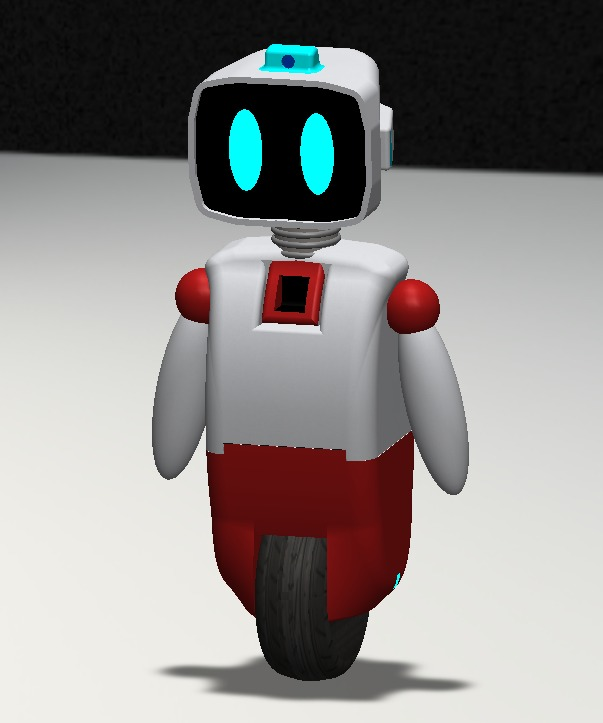
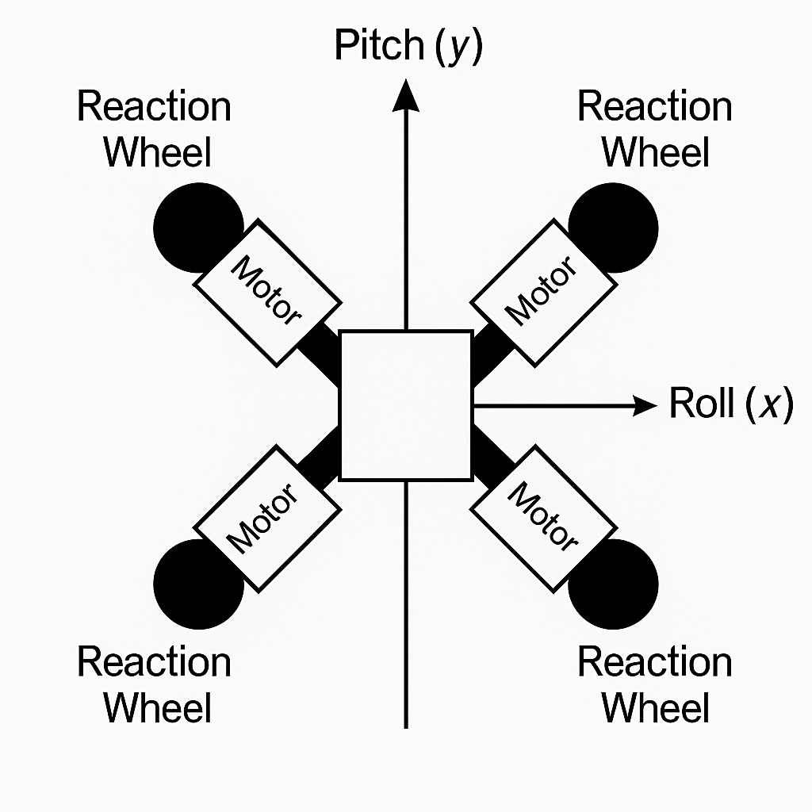
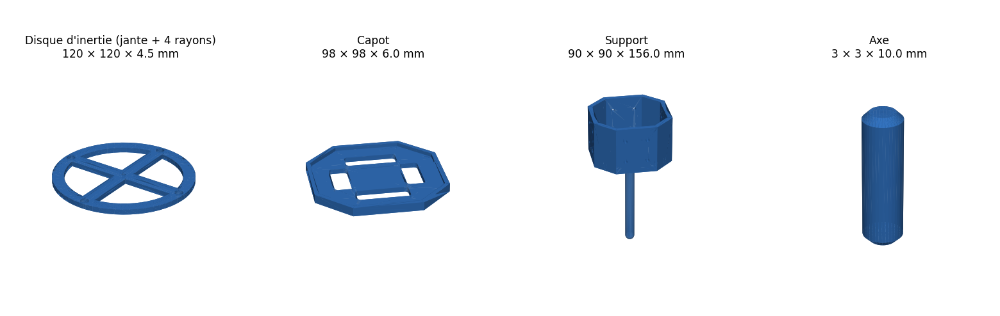
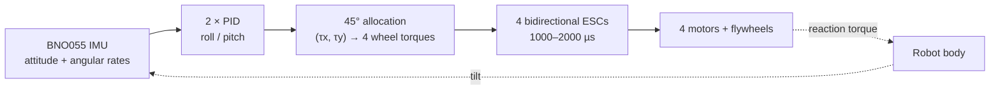

# Reaction-wheel stabilisation of a self-balancing monowheel robot

**Crystof** is the mascot robot of the CRYSTEO student association (JUNIA, Lille, France): a robot that balances on a single wheel. This repository documents the subsystem I designed to keep it upright: **four reaction wheels at 45°, an ESP32, a BNO055 IMU and a two-axis PID attitude controller**, from the first hand calculations to the embedded firmware.

<p align="center">
  
  &nbsp;
  
</p>
<p align="center">
  
</p>

| | |
| --- | --- |
| **My role** | Stabilisation subsystem: sizing, architecture, system model, CAD, firmware and test tooling |
| **Context** | Student association project (CRYSTEO, JUNIA), October 2025 to today, alongside my engineering degree |
| **Tools** | C++ on ESP32 (PlatformIO, Arduino, FreeRTOS) · MATLAB/Simulink · SolidWorks and 3D printing · Capella (Arcadia MBSE) |
| **Status** | TRL 3: components validated separately; single-axis bench test ready ([TRL 4 plan](docs/05-plan-trl4.md)) |

## Highlights

- **Sizing from first principles.** Correcting a 10° tilt in 0.4 s on a 6.5 kg, 50 cm robot needs 3.3 N·m, i.e. 1.17 N·m and about 20 A per wheel. [Sizing](docs/02-dimensionnement.md)
- **Redundant four-wheel architecture.** Each wheel acts on both roll and pitch; the controller's torque is split across the wheels by pseudo-inverse allocation. [Architecture](docs/03-architecture-4-roues.md)
- **Modular embedded firmware.** My own BNO055 I2C driver, an ESC driver with arming and failsafe, a wheel-array layer and a two-axis PID with 45° allocation, at 200 Hz. [Firmware](firmware/README.md)
- **Real-time design.** The single-axis test runs on FreeRTOS `vTaskDelayUntil()`, counts every missed deadline and streams JSON telemetry to PlotJuggler.
- **Hardware-in-the-loop tooling.** A Simulink dashboard drives the motor over a serial link, with a keep-alive so the ESP32 failsafe never triggers by accident. [MATLAB](matlab/README.md)
- **System model.** A Capella model of the whole robot across the five Arcadia levels: balance, propulsion, power and safety, telemetry, user interface. [Capella](capella/README.md)
- **An engineering review that changed the plan.** Before any bench test, I checked the torque budget: the motor actually bought (A2212) delivers **6 to 12 times less torque** than required. I re-scoped the first test to validate the control chain only, instead of tuning a system that physically could not work. [Torque review](docs/04-revue-budget-de-couple.md)

## How it works



Accelerating a flywheel one way pushes the robot body the other way. The controller reads the tilt, computes the roll and pitch torques needed to bring the body back to vertical, splits them across the four wheels and sends the commands to the motor controllers, 200 times per second.

## Key figures

| Quantity | Value |
| --- | --- |
| Robot mass, height | 6.5 kg, 50 cm |
| Disturbance to correct | 10° in 0.4 s |
| Total torque needed | 3.3 N·m (84 % of it to fight gravity) |
| Torque per wheel | 1.17 N·m |
| Current per motor (160 KV class) | ≈ 20 A, 80 A for the four |
| Control loop | 200 Hz on ESP32 |
| Torque available from the A2212 | 0.10 to 0.13 N·m continuous |

## How the project evolved

The commit history follows these phases. Dates below are the original file dates.

| When | Milestone | Where |
| --- | --- | --- |
| Oct 2025 | Literature review: Wheelbot, KTH reaction-wheel robot, LQG-controlled monowheel, gyroscopes | [references](docs/references.md) |
| 21 Oct 2025 | First hand calculations: torques, inertias, first motor choice | [scan](docs/sources/2025-10-21_calculs-manuscrits-dimensionnement.pdf) |
| 7–8 Nov 2025 | Sizing note and four-wheel configuration study | [sizing](docs/02-dimensionnement.md), [architecture](docs/03-architecture-4-roues.md) |
| Dec 2025 | Sponsorship file; Capella system model | [sponsorship](docs/sources/2025-12-03_dossier-sponsoring.pdf), [capella/](capella/README.md) |
| Jan 2026 | Reaction-wheel CAD and 3D-printed parts; BNO055 and ESC drivers; Simulink motor tooling | [cad/](cad/README.md), [archive](firmware/archive/README.md), [matlab/](matlab/README.md) |
| Feb 2026 | Stabilisation assembly; modular firmware with PID and 45° allocation | [firmware/](firmware/README.md) |
| Sep 2026 | Engineering review: torque budget, TRL 4 plan, real-time single-axis test | [review](docs/04-revue-budget-de-couple.md), [plan](docs/05-plan-trl4.md) |
| Next | Single-axis bench test, then four wheels on a gimbal | [plan](docs/05-plan-trl4.md) |

## Repository map

```
├── docs/                 engineering documentation (French), original dated sources, images
├── firmware/
│   ├── stabilisation/    reference PlatformIO project (4-wheel version + single-axis test)
│   └── archive/          earlier firmware steps, in chronological order
├── matlab/               Simulink tooling to drive and characterise the motors
├── cad/                  SolidWorks parts and assemblies, 3D-printing files, renders
└── capella/              Capella system model of the whole robot
```

## Build the firmware

```bash
cd firmware/stabilisation
pio run -e esp32doit-devkit-v1 -t upload            # full 4-wheel version
pio run -e test_single_axis -t upload -t monitor     # single-axis bench test
```

## Status and next steps

- **Done:** sizing, architecture, system model, CAD, drivers and controller firmware, motor tooling, torque review.
- **Next:** single-axis bench test with a success criterion written before the test; then four wheels on a two-axis gimbal; then free balancing.
- **Open decision:** the final robot needs either motors in the class of the Eaglepower 8308 or a much smaller, lighter body.
- **Known issues** are listed openly in the [firmware notes](firmware/README.md#points-connus-à-traiter-avant-les-essais-sur-banc) and the [sizing review](docs/02-dimensionnement.md#27-relecture-critique-octobre-2026).

## Credits

The Crystof project was defined by the CRYSTEO association in 2024–2025 (initial brief and budget, written by other members). This repository covers my contribution to the stabilisation subsystem. Papers, datasheets, vendor CAD models and MathWorks examples are [referenced](docs/references.md), not redistributed.

This repository was assembled in October 2026 from the original project files.

---

## Résumé en français

**Stabilisation par roues de réaction d'un robot monowheel auto-équilibré.** Crystof est le robot mascotte de l'association CRYSTEO (JUNIA, Lille). J'en ai conçu le sous-système d'équilibre, d'octobre 2025 à aujourd'hui :

- dimensionnement des couples et des inerties (3,3 N·m pour corriger 10° en 0,4 s) ;
- architecture à quatre roues de réaction à 45° ;
- modèle système Capella ;
- CAO SolidWorks et pièces imprimées en 3D ;
- firmware ESP32 (driver BNO055, ESC, PID deux axes, 200 Hz, FreeRTOS) ;
- outils Simulink pour piloter et caractériser les moteurs.

Une revue de conception a montré que le moteur acheté fournit 6 à 12 fois moins de couple que nécessaire. Le premier essai sur banc a donc été recentré sur la validation de la chaîne de commande.

Toute la documentation technique est en français : [commencer ici](docs/README.md).
