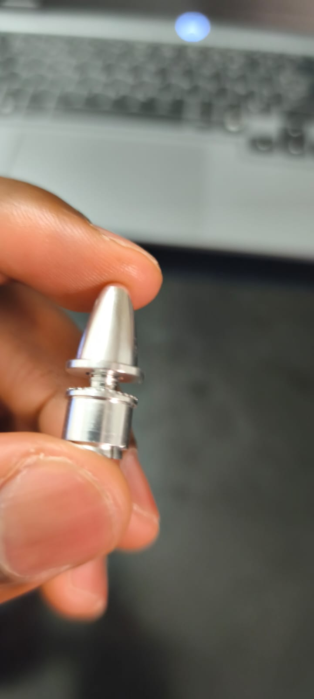

# CAO de la roue de réaction (SolidWorks, janvier-février 2026)

*Rendu généré à partir des fichiers STL du dossier [`impression-3d/`](impression-3d/).*

## Pièces

| Pièce | Fichier SolidWorks | Fichier d'impression | Encombrement | Rôle |
| --- | --- | --- | --- | --- |
| Disque d'inertie | `disque.SLDPRT` | `disque.STL`, `disque.3mf` | Ø 120 × 4,5 mm | Volant : une jante et quatre rayons, pour placer la masse en périphérie |
| Capot | `cap.SLDPRT` | `cap.STL`, `cap.3mf` | 98 × 98 × 6 mm | Plaque octogonale ajourée qui ferme le support |
| Support | `support.SLDPRT` | `support.STL`, `support.3mf` | 90 × 90 × 156 mm | Logement octogonal prolongé d'une tige, révisé le 26/02/2026 |
| Axe | `axe.SLDPRT` | `axe.STL` | Ø 3 × 10 mm | Petit axe cylindrique |
| Visserie | `vis10.SLDPRT`, `vis20.SLDPRT`, `ecrous.SLDPRT` | | | Fixation du disque sur le moteur |

## Assemblages

| Assemblage | Contenu |
| --- | --- |
| `disque_vis.SLDASM` | Disque et visserie |
| `Système de stabilisation.SLDASM` | Ensemble de stabilisation : support, capot, disque et visserie, moteur A2212 (01/02/2026) |
| `rxn_wheel.SLDASM` | Ensemble roue de réaction (02/02/2026) |

Les noms des fichiers SolidWorks sont ceux d'origine : les renommer casserait les références des assemblages.

## Composants du commerce non inclus

Les modèles 3D du moteur A2212, de la carte ESP32 et de l'hélice de test 8 × 4,5 venaient de bibliothèques de fournisseurs ou de la communauté. Ils ne sont pas redistribués ici. À l'ouverture d'un assemblage, SolidWorks les signale comme manquants : il suffit de les remplacer par un modèle équivalent ou de les supprimer.

## Écart avec le dimensionnement

Le volume du disque, mesuré sur son maillage, est de 24,5 cm³. Le calcul prévoyait un volant de 0,25 kg de rayon 80 mm ; ce disque fait 60 mm de rayon et pèse environ 30 g en PLA ou 66 g en aluminium. Voir la [revue du budget de couple](../docs/04-revue-budget-de-couple.md).

*Adaptateur de moyeu (« prop adapter ») utilisé pour fixer le disque sur l'arbre du moteur, février 2026.*
