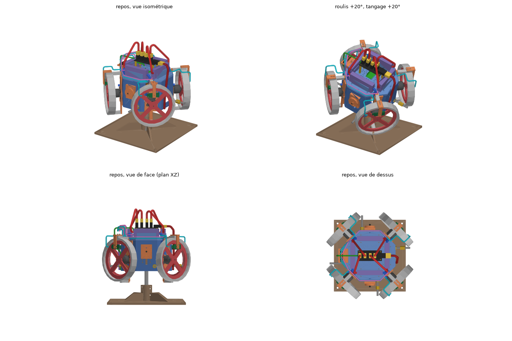
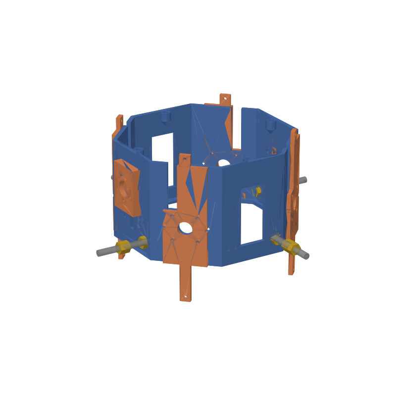
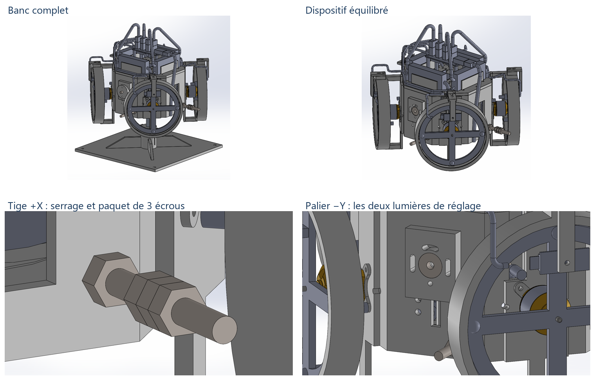
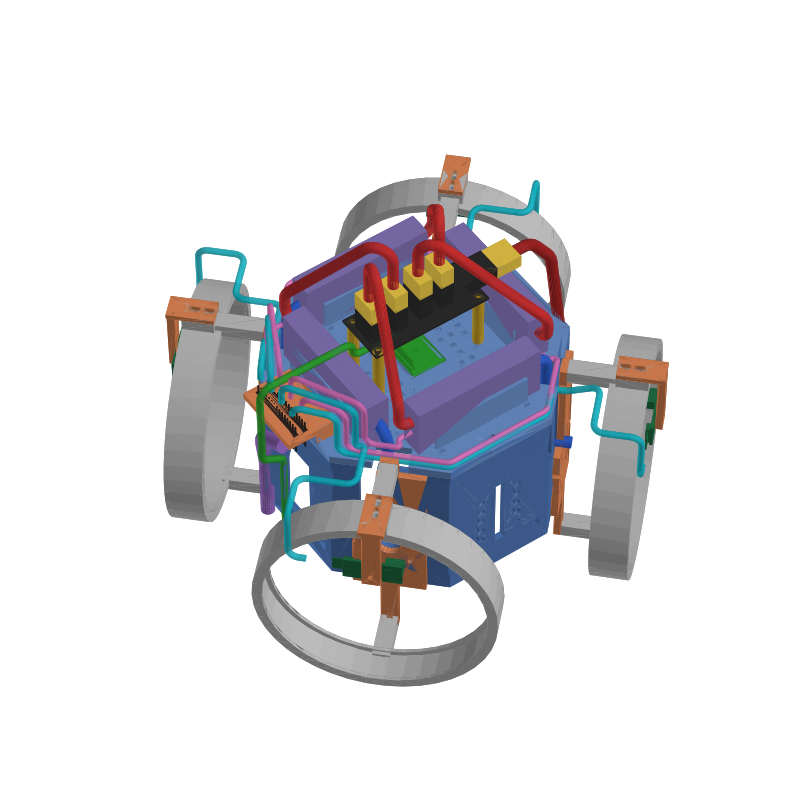
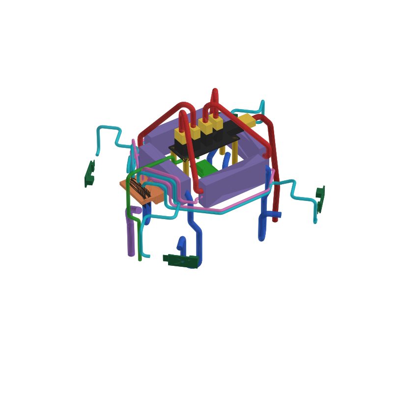
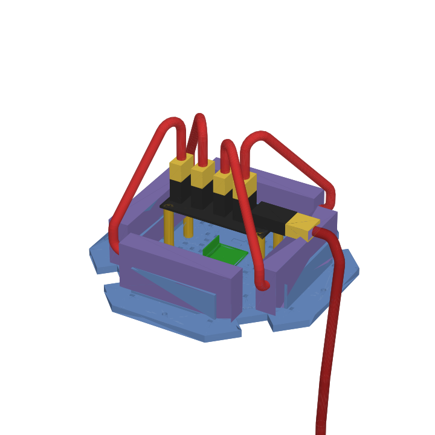
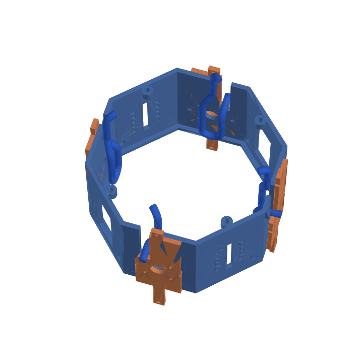

# Banc de stabilisation à 4 roues de réaction

Le dispositif de stabilisation est monté sur un cardan à deux axes, posé sur un socle de table. Il peut s'incliner librement en roulis et en tangage, de −20° à +20° sur chaque axe. On peut bloquer un axe pour faire d'abord le test à un axe.

**Phase de test : le banc s'adapte au câblage existant.** Les ESC gardent leurs fils moteur soudés et leur prise XT60. La carte de distribution XT60 1 vers 4 déjà achetée (Jonronfey) et l'alimentation de labo sont reprises telles quelles. L'ESP32 et le régulateur restent sur la table, sur la breadboard, en attendant une carte imprimée. Le dispositif ne porte que ce qui doit bouger avec lui :

- les 4 modules de roue, chacun avec son capteur de vitesse TCRT5000 ;
- les 4 ESC, debout sur l'étage (le plateau supérieur), autour du BNO055 ;
- la carte de distribution XT60 1 vers 4, au centre de l'étage, sur 4 entretoises ;
- un bornier à deux rangées : câbles de commande des ESC et câbles des capteurs.

Deux câbles souples le relient à la table, par des faces opposées : les signaux par la face −X, l'alimentation par la face +X.

Version 3.1 du 13/11/2026, construite et contrôlée par les scripts de `sources/`. **Tout le câblage est dessiné dans SolidWorks**, câble par câble, au diamètre et à la longueur réels.

## Ce qui change dans la version 3.1 : le banc équilibré

| Avant | Version 3.1 | Pourquoi |
| --- | --- | --- |
| Paliers vissés par 2 trous sur 5 rangées d'inserts | 2 lumières verticales de ±4 mm par palier (RW-04) | Toute hauteur de pivot de −12 à +28 mm, pour le mettre exactement au centre de gravité |
| Pivot monté à +24 | Pivot à +25 (rangée +24, paliers remontés de 1 mm) | Hauteur calculée pour que le centre de masse soit sur l'axe de tangage |
| Lest à improviser (rondelles dans un passe-collier) | 4 tiges filetées M6 × 60 (RW-40) sur les faces ±X et ±Y, à z −20, à 25 mm du milieu de la face, en moulin, écrous M6 (RW-41) de serrage et de réglage | Masses réglables : nombre d'écrous pour le grossier, position pour le fin |
| Centre de gravité à x −0,7 mm | Centre de gravité sur les axes (x 0,00, y −0,06 mm) | Le décalage latéral créait un couple permanent de ≈ 9 N·mm |

Réglage du modèle : 3 écrous de réglage sur la tige +X (milieu du paquet à 104,9 mm du centre), 1 sur +Y (89,1 mm), aucun sur −X, 2 sur −Y (103,6 mm). Dans SolidWorks, chaque paquet est placé par une contrainte nommée « Équilibrage ±X/±Y : position du paquet… » (distance de sa face intérieure à la paroi), et la hauteur du pivot par « Hauteur du pivot de tangage, palier +Y » et « … −Y ». Modifier la valeur suffit : les autres écrous du paquet s'appuient sur le premier.

## Ce qui change dans la version 3

La version 2 logeait les ESC dans le corps, pour un ESC supposé de 50 mm. Mesures faites depuis : ESC de 78 mm, 18 cm de fil entre le moteur et l'ESC, 13 cm entre l'ESC et sa XT60, fil silicone 16 AWG 200 °C (Ø 3,0 mm).

| Version 2 | Version 3 | Pourquoi |
| --- | --- | --- |
| ESC de 50 × 26 × 11 mm dans une glissière du corps | ESC de 80 × 32 × 14 mm (enveloppe) debout sur l'étage, entre deux joues, tenu par 2 colliers | L'ESC réel fait 78 mm : il ne tenait pas dans une face de 63 mm |
| Paires XT60 et nœud du faisceau dans le corps | La carte de distribution XT60 1 vers 4 (Jonronfey) au centre de l'étage, sur 4 entretoises M3 × 35, au-dessus des ESC | Chaque ESC s'y branche directement avec ses 13 cm ; à plat, la fiche d'entrée aurait buté dans l'ESC +X |
| Surplus de câble sur des taquets, non dessiné | Chaque câble dessiné à sa longueur : boucle des fils moteur contre la face intérieure, quart de tour des fils d'alimentation | Voir ce qui s'emboîte, vérifier qu'aucun câble n'en traverse un autre |
| Capteur entre le corps et le disque, repères à coller | Capteur sur une potence en haut du carter, devant la face extérieure du disque : il lit les 4 rayons | Le disque est ajouré (aucune face pleine où coller des repères) ; plus de place, accès direct |
| 4 passe-fils dans le plateau | 4 encoches de coin, ouvertes sur le bord | Les fils (soudés à l'ESC) s'engagent par le côté, sans rien enfiler |
| Pivots de +8 à −24 mm | Pivots de +24 à −8 mm | Les ESC et la carte de distribution en haut remontent le centre de gravité à z ≈ +28 mm |

### À quoi servent les barrettes du bornier

Le câble de commande de chaque ESC finit par une prise femelle, et un fil Dupont vers la breadboard aussi. Il faut entre les deux une broche mâle des deux côtés : la barrette est cette rallonge mâle-mâle, tenue dans une pièce fixe. Les prises ne pendent pas, et le dispositif se débranche de la table d'un geste. Une rangée pour les 4 ESC, une pour les 4 capteurs.

## Documents

| Document | Contenu |
| --- | --- |
| [Documentation-technique_banc-stabilisation.pdf](Documentation-technique_banc-stabilisation.pdf) | Fiche de chaque composant (fonction, rôle, caractéristiques, dimensionnement, fabrication, approvisionnement), câblage et brochage, montage, équilibrage, sécurité, contrôles |
| [Carnet-de-commandes_banc-stabilisation.pdf](Carnet-de-commandes_banc-stabilisation.pdf) | Pièces à imprimer en PLA (≈ 903 g, ≈ 41 h), liste d'achats par fournisseur, budgets : 87 € pour le banc, 152 € avec la phase batterie, 299 € en rachetant tout |

## Fichiers

| Fichier | Contenu |
| --- | --- |
| `Banc_stabilisation.SLDASM` | Banc complet : socle (fixe), poteau, cardan et dispositif. Deux pivots libres (roulis, tangage), limités par les contraintes « Butées de roulis (±20°) » et « Butées de tangage (±20°) » |
| `Dispositif.SLDASM` | Corps central (fixe), 4 modules de roue, plateau supérieur, 4 ESC, bornier et ses 2 barrettes, BNO055, carte de distribution XT60 sur 4 entretoises et ses 5 fiches (encombrements), 7 pièces de câblage, paliers de tangage à lumières, 4 tiges d'équilibrage et leurs 14 écrous |
| `Module_roue.SLDASM` | Platine moteur (fixe), carter, A2212, disque `disque_vis` (pivot libre), potence du capteur, TCRT5000 ; monté 4 fois |
| `RW-01` à `RW-12` | Pièces imprimées (RW-09, le berceau de batterie, est pour la phase batterie : créé mais pas monté) |
| `RW-20` à `RW-38` | Composants du commerce et faisceau existant, en volumes simples (RW-26, 30, 34 et 35 : phase batterie) |
| `RW-40`, `RW-41` | Tige filetée M6 × 60 et écrou M6 de l'équilibrage |
| `RW-50` à `RW-56` | Câblage, une pièce par famille : fils moteur, alimentation des ESC, câble d'alimentation de la carte, commandes des ESC, capteurs, BNO055, nappe des signaux |
| `A2212.SLDPRT` | Moteur, importé de `A2212 BLDC Motor v1.step` |
| `cao/` | STEP de chaque pièce. Les STEP d'assemblage (50 Mo, à cause du modèle A2212) restent hors Git |
| `rendus/` | Vues du banc, coupe du cardan, étage câblé, câblage seul, dessous du plateau, module de roue, images des pièces |
| `sources/` | Scripts de conception, de contrôle, de construction SolidWorks, de rendu et des deux PDF |

`disque_vis.SLDASM` (et ses pièces) est le fichier d'origine, rangé dans le dossier SolidWorks parent du banc. Le banc le référence sans le modifier : une modification du disque s'y retrouve.

Toutes les contraintes sont au strict minimum, avec une seule pièce fixe par assemblage. Au total, 168 contraintes (Module_roue 11, Dispositif 125, Banc 32), dont les 2 butées.

## Repère et architecture

Le repère est celui de « Système de stabilisation.SLDASM » :

- Z vers le haut ;
- X = axe de roulis, Y = axe de tangage ;
- origine au centre du corps, à la hauteur des axes des moteurs.

Les 4 A2212 ont leur axe horizontal sur les diagonales : moteur 1 à 45° (+X, +Y), puis 135°, 225° et 315°. Chaque roue agit donc à cos 45° sur le roulis et sur le tangage, comme dans le firmware (`mix45_`).

- **Corps central (RW-01).** Octogone de 160 mm sur plats, parois de 4 mm, de z −35 à +60, ouvert en haut. Il ne porte plus d'électronique.
  - Faces diagonales : croix de l'A2212 et fente des fils moteur, ouverte vers le haut : les fils, soudés au moteur et à l'ESC, s'y posent par-dessus, plateau retiré. Rien n'est à enfiler ni à dessouder.
  - Faces ±Y : paliers de tangage (5 positions). Faces ±X : fenêtre d'accès aux goupilles de roulis, fentes du collier du câble qui descend.
- **Module de roue (RW-02 platine, RW-03 carter, RW-12 potence).**
  - La platine se plaque sur la face du corps ; les 4 vis de la croix de l'A2212 serrent moteur, platine et paroi. La face d'appui du moteur est à 84 mm du centre.
  - Le carter est un anneau Ø135 autour du disque. En haut, un bossage reçoit la potence du capteur.
  - La potence descend devant la face extérieure du disque et tient la carte TCRT5000 à 4 mm du disque (réglable de ±2 mm), à 41,5 mm de l'axe : le capteur voit passer les 4 rayons, soit 4 impulsions par tour, sans rien coller.
- **Étage (RW-08, plateau supérieur).** Plaque de 5 mm, 4 vis, avec :
  - le BNO055 au centre, carte tournée de 90°, broches vers le haut, barrette côté −X, flèche +X gravée ;
  - les 4 ESC debout en couronne, à 53 mm du centre, chacun entre deux joues et tenu par 2 colliers ; bout moteur vers le coin de son moteur ;
  - une encoche dans chaque coin, ouverte sur le bord : les fils moteur y montent, les fils d'alimentation y descendent ;
  - des passe-colliers (tunnels dans l'épaisseur), utilisables par-dessus et par-dessous.
- **Carte de distribution XT60 1 vers 4 (RW-37).** La carte Jonronfey, au centre de l'étage, sur 4 entretoises M3 × 35 : son dessous passe 3 mm au-dessus des ESC, et la fiche du câble d'alimentation, branchée sur l'entrée côté +X, passe par-dessus l'ESC +X. Sorties de +X vers −X : ESC 2, ESC 1, ESC 3, ESC 4, pour qu'aucun fil n'en croise un autre. La LED de polarité reste visible. Cotes prises sur l'annonce (74 × 32 mm, M3) et la photo du vendeur : à vérifier sur la carte.
- **Bornier (RW-11).** Bloc sur le bord −X avec une lèvre en porte-à-faux. Deux barrettes mâles 1 × 15 à broches longues : rangée intérieure pour les prises des 4 ESC (dans l'ordre d'arrivée des câbles : ESC 2, 3, 4, 1), rangée extérieure pour les 4 capteurs (1, 2, 3, 4). Dessous, des fils Dupont femelle-mâle partent vers la breadboard.
- **Cardan.**
  - Le croisillon (RW-06), un cube de 28 mm, est au centre du corps.
  - Roulis : deux vis épaulées Ø5 vissées dans le croisillon tournent dans deux roulements 625 de la fourche (RW-07), montée sur le poteau.
  - Tangage : une tige Ø5 × 200, serrée dans le croisillon, tourne dans deux roulements 625 portés par les paliers (RW-04), vissés sur les faces ±Y du corps.
  - Deux colliers (RW-05) arrêtent la tige.
- **Butées et blocage.**
  - Sur chaque axe, une goupille emmanchée court dans une lumière en arc de ±20° : c'est la butée.
  - Une seconde goupille, amovible, passe dans deux trous alignés au repos et bloque l'axe.
- **Câbles vers la table.**
  - La nappe des signaux (15 fils : ESC, capteurs, BNO055) descend la face −X du corps, en deux paquets : l'I2C n'est pas torsadé avec les commandes des ESC.
  - Le câble d'alimentation du faisceau descend la face +X.
  - Chacun est attaché au corps, fait une boucle libre d'environ 10 cm, puis est attaché dans un tunnel du moyeu du socle.
- **Socle (RW-10).** 240 × 240 mm, 4 nervures, collier de serrage du tube (2 vis M4), 2 tunnels pour les colliers des câbles, 4 trous Ø6,5. Une planche de bois ou de MDF percée peut le remplacer.

## Câblage dessiné

Chaque câble est un tube à son diamètre réel, coudes arrondis, dans `Dispositif.SLDASM`. Le fil silicone 16 AWG 200 °C (252 brins de 0,08 mm) fait 3,0 mm de diamètre extérieur.

| Câble | Enveloppe | Longueur | Cheminement |
| --- | --- | --- | --- |
| Fils moteur (3 × 16 AWG), × 4 | Ø 6,5 mm | 180 mm, mesurée | Base du moteur, fente ouverte de la paroi, boucle contre la face intérieure, encoche du coin, bout moteur de l'ESC |
| Alimentation de l'ESC (2 × 16 AWG), × 4 | Ø 6,0 mm | 130 mm, mesurée | Bout alimentation de l'ESC, montée dans le coin, diagonale au-dessus des ESC, fiche XT60 sur sa sortie de la carte |
| Câble d'alimentation de la carte | Ø 6,5 mm | ≈ 15 cm sur le dispositif | De la fiche branchée sur l'entrée, par-dessus l'ESC +X, puis le long de la face +X |
| Commande de l'ESC (3 fils), × 4 | Ø 3,0 mm | 107 à 227 mm (câble existant : ≈ 25 cm) | Bordure du plateau, puis vol jusqu'au bornier |
| Capteur de vitesse (3 fils Dupont), × 4 | Ø 3,5 mm | 203 à 341 mm | Par-dessus le carter, bordure du plateau, bornier |
| BNO055 (4 fils Dupont) | Ø 4,0 mm | 239 mm sur le dispositif | Sous la carte de distribution, au-dessus de l'ESC −X et du bornier, puis face −X |

Rayon de courbure du 16 AWG en faisceau : 8 mm au moins. Aucun câble n'en traverse un autre ; le plus petit écart entre deux câbles est de 0,2 mm (ils se longent).

## Brochage de l'ESP32

| Fonction | Broches |
| --- | --- |
| I2C du BNO055 (100 kHz) | 21 (SDA), 22 (SCL) |
| ESC 1 à 4 | 25, 26, 27, 32 |
| Capteurs de vitesse 1 à 4 (D0 des TCRT5000, alimentés en 3,3 V) | 36, 39, 34, 35 (entrées seules) |

## Réglage du centre de rotation

Les paliers de tangage se vissent sur l'une des 5 paires d'inserts des faces ±Y, et glissent de ±4 mm dans leurs lumières. h est la hauteur du centre de gravité au-dessus du centre de rotation : plus h est grand, plus l'essai est difficile. Sans batterie, avec les tiges d'équilibrage, le centre de gravité est à z = +25,6 mm dans le modèle de la documentation (le jumeau numérique, qui prend le moteur et le disque relevés dans SolidWorks, le place à +25,0).

| Position du pivot (z) | h | Couple de gravité à 5° | Usage |
| --- | --- | --- | --- |
| +25 mm (montée dans le modèle : rangée +24, paliers remontés de 1 mm) | 0,6 mm | 1 N·mm | Équilibré : équilibrage statique, essais des roues |
| +24 mm | 1,6 mm | 2 N·mm | Presque neutre |
| +16 mm | 9,6 mm | 11 N·mm | Premiers essais en boucle fermée |
| +8 mm | 17,6 mm | 19 N·mm | Essais standard |
| 0 mm | 25,6 mm | 28 N·mm | Essais exigeants |
| −8 mm (−12 au bas des lumières) | 33,6 mm | 37 N·mm | Limite |

Les 4 A2212 donnent environ 0,19 N·m par axe à 10 A (fiche du moteur, non mesuré). Un décalage latéral du centre de gravité de 1 mm crée un couple permanent d'environ 13 N·mm : c'est ce que les écrous de réglage compensent (un écrou déplacé de 10 mm déplace le centre de gravité de ≈ 0,02 mm).

Dans SolidWorks, la hauteur se change dans les contraintes nommées « Hauteur du pivot de tangage, palier +Y (rangée +24 : de +20 à +28 mm) » et « … palier −Y » (même valeur des deux côtés).

## Chiffres de conception

| Grandeur | Valeur | Origine |
| --- | --- | --- |
| Masse de la partie mobile | ≈ 1 287 g, dont 76 g de tiges et d'écrous d'équilibrage | Calcul : pièces imprimées à 0,8 g/cm³, A2212 58 g, disque et vis 50 g, ESC 28 g, TCRT5000 3 g, câbles à leur masse linéique (16 AWG : 18 g/m par fil), croisillon, tige et colliers. À peser |
| Centre de gravité | z = +25,6 mm ; x 0,00, y −0,06 mm | Même calcul |
| Débattement | ±20° en roulis et en tangage, butées mécaniques | Lumières en arc |
| Hauteur du centre de rotation | Environ 162 mm au-dessus de la table | Dessus du socle 156 mm sous le pivot, 15 mm sous le point le plus bas du dispositif à ±20° combinés |
| Vitesse conseillée des disques | ≈ 3 900 tr/min (commande 1375 à 1625 µs) | Tenue des vis d'équilibrage dans 1,5 mm de PLA (documentation, section 9) |
| Mesure de vitesse | 4 impulsions par tour (les 4 rayons du disque), ≈ 260 par seconde à 3 900 tr/min | Mesurer la durée entre deux fronts, pas compter par période de boucle |

## Contrôles faits

| Contrôle | Résultat |
| --- | --- |
| Interférences au repos (Python, build123d), câbles, tiges et écrous compris, disques pris par leur enveloppe en rotation, pivot en haut de course (+28), équilibré (+25) et en bas de course (−12) | Aucune |
| Jeux autour des tiges et des écrous d'équilibrage, sur toute la course des paliers | 2,2 mm aux paliers (pivot au plus bas), 2,3 mm entre le bout des tiges et les carters (fixes l'un par rapport à l'autre), 4,8 mm aux colliers, 9,2 mm aux disques en rotation |
| Balayage du cardan : roulis et tangage de −20° à +20° par pas de 10°, coins combinés compris, câbles et tiges compris, contre fourche et poteau | Aucun contact pour les 5 rangées, le pivot équilibré et les deux bouts des lumières ; socle à 14 mm sous le point le plus bas au pivot +25 (11 mm à +28) |
| Import des pièces dans SolidWorks | Chaque pièce imprimée ou du commerce est un seul corps solide ; la construction s'arrête si un import échoue |
| Assemblages SolidWorks rouverts (13/11/2026) | 0 contrainte en erreur, une seule pièce fixe par assemblage, aucune pièce sous-contrainte sauf le disque (libre en rotation, voulu) |
| Détection d'interférences de SolidWorks (vrais modèles A2212 et disques, tiges et écrous compris) | Aucune à corriger. Recouvrements voulus : goupilles Ø3 emmanchées dans des trous Ø2,9. Il reste aussi un chevauchement de 22 mm³ entre la vis `vis20-2` et le disque, à l'intérieur du `disque_vis` d'origine |

## Points à confirmer

- **Largeur et épaisseur de l'ESC, à mesurer avant d'imprimer le plateau** : les joues sont faites pour 14 mm d'épaisseur et 32 mm de haut (longueur mesurée : 78 mm). Et le côté de sortie des fils : le modèle suppose les fils moteur d'un bout, l'alimentation et la commande de l'autre.
- **Cotes de la carte de distribution XT60** : longueur, largeur, entraxe des trous, position des sorties et de l'entrée. Le modèle part de l'annonce (74 × 32 mm, trous M3) et de la photo du vendeur.
- **Carte TCRT5000** (cotes, sens des broches) et **GY-BNO055**. Elles se reprennent dans `sources/rw_params.py`.
- **Réponse du TCRT5000 sur le PLA du disque** : à essayer ; au besoin, adhésif aluminium ou blanc sur les rayons.
- **Matériel disponible** : nombre de moteurs et d'ESC, courant maximal de l'alimentation de labo.
- **Firmware** : ESC sur 25, 26, 27, 32 ; capteurs sur 36, 39, 34, 35 ; I2C sur 21 et 22, à 100 kHz.
- **BNO055** : mode IMUPLUS plutôt que NDOF, car les aimants des A2212 faussent le magnétomètre.
- **Couple réel de l'A2212 et vitesse maximale du disque** : à mesurer sur le banc à un moteur.

## Régénérer

Toutes les cotes viennent de `sources/rw_params.py`.

1. `python rw_pieces.py ../cao [pièces]` (Python avec build123d) : les STEP de toutes les pièces, ou seulement de celles nommées. `python rw_cables.py ../cao` : longueurs, rayons de courbure, écarts entre câbles et STEP des câbles.
2. `python rw_verif.py` : interférences, balayage du cardan, centre de gravité et hauteur du socle.
3. `python -I rw_sw.py` (Python système avec pywin32, SolidWorks fermé) : pièces, `Module_roue`, `Dispositif` et `Banc_stabilisation`, avec leurs contraintes. `python -I rw_sw.py assemblages` refait seulement les assemblages ; `python -I rw_sw.py pieces RW-xx_… …` refait ces pièces puis les assemblages.
4. `python -I verif_liaisons.py <chemin absolu de l'assemblage>` (réouverture, contraintes en erreur, pièces sous-contraintes) et `python -I rw_interferences.py` (détection d'interférences de SolidWorks).
5. `python rw_rendus.py [vues] [cardan] [interface] [module] [equilibrage]` : rendus (environ 20 min pour tous).

Après un changement de masse ou de position d'une pièce du dispositif : `python preparer_cao.py --equilibrer` (dans `jumeau_numerique/construction/`) recalcule le nombre et la position des écrous de réglage et la hauteur du pivot, à reporter dans `rw_params.py` (`EQ_ECROUS`, `EQ_POSITIONS`, `Z_PIVOT_EQUILIBRE`).
6. `python rw_documents.py` : la documentation technique et le carnet de commandes en PDF (`rw_calculs.py` fait les calculs).

Les scripts refusent de s'attacher à une session SolidWorks ouverte : ils ferment tous les documents.

Les outils de contraintes (`liaisons.py`, `contraindre.py`, `swbuild.py`) viennent du banc 2DDL du PFE HEI5. `liaisons.py` y a gagné deux évolutions :

- la lecture de tous les corps d'une pièce, nécessaire pour l'A2212 importé, qui a 39 corps ;
- une tolérance de rotation ramenée à la taille des pièces.
