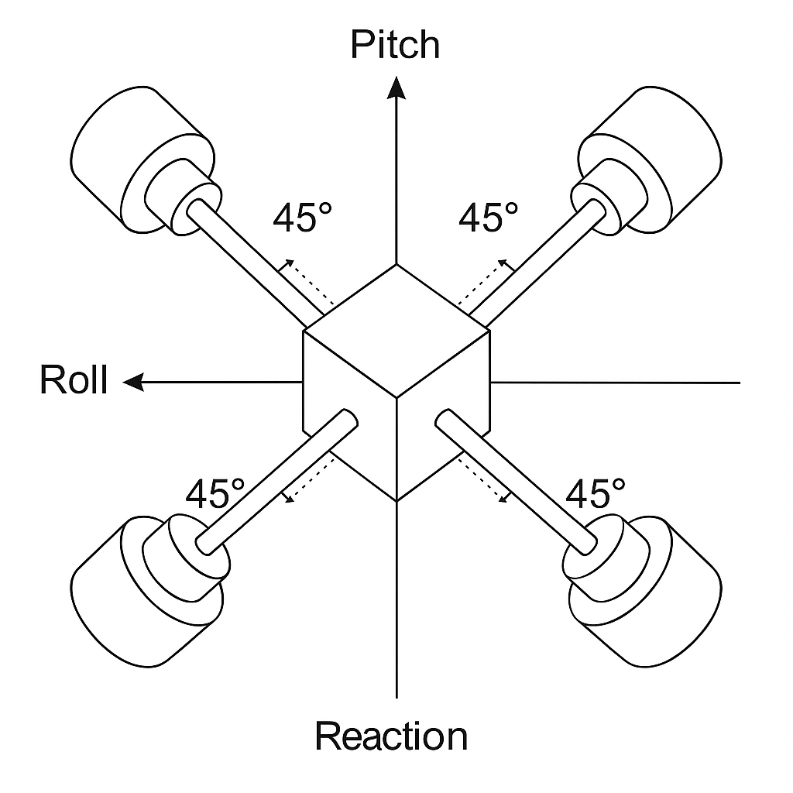
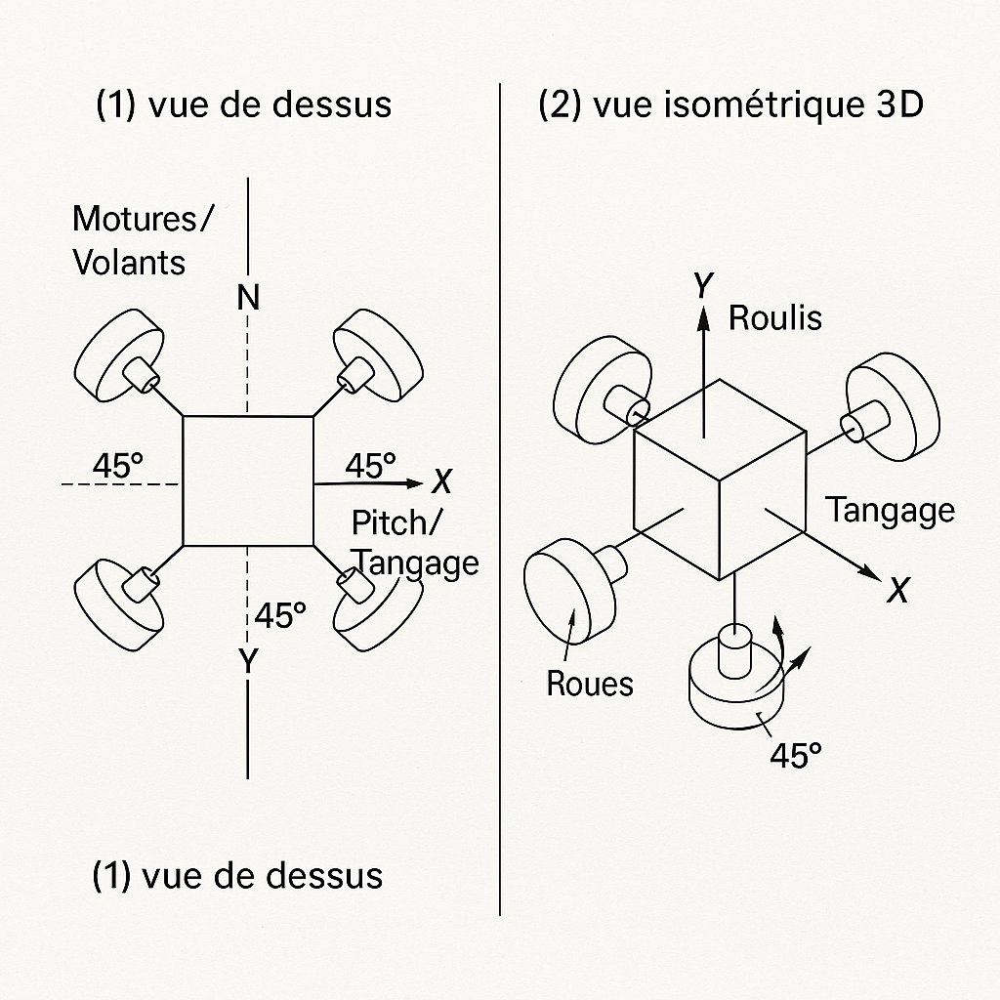

# 3. Architecture à quatre roues de réaction

Source : [étude de configuration du 08/11/2025](sources/2025-11-08_configuration-4-roues-inertie.pdf).

## 3.1 Configuration retenue

Quatre roues de réaction sont disposées à plat autour du centre du robot, en croix, chacune orientée à 45° des axes de roulis (x) et de tangage (y).

  
  
  

Chaque roue contribue à la fois au roulis et au tangage, avec un facteur cos 45° ≈ 0,707 sur chaque axe.

| Avantages | Contraintes |
| --- | --- |
| Commande simultanée du roulis et du tangage | Allocation du couple entre 4 actionneurs pour 2 axes (pseudo-inverse ou optimisation) |
| Efforts, courants et échauffement répartis sur 4 moteurs | Synchronisation fine pour éviter un couple parasite en lacet |
| Redondance : une roue en panne peut être compensée par les trois autres | Forte consommation : 80 à 100 A en manœuvre, batterie à forte décharge |
| Couples parasites en lacet en partie annulés par la symétrie | Montage mécanique précis à 45° et volants bien équilibrés |
| Mêmes moteurs, mêmes réglages pour les 4 roues | Masse et câblage supplémentaires |

## 3.2 Allocation du couple

Le contrôleur calcule un couple de roulis τx et un couple de tangage τy. Il faut les répartir sur les quatre roues. Avec les axes des roues orientés selon (±cos 45°, ±cos 45°), le couple produit vaut :

$$
\begin{pmatrix}\tau_x\\ \tau_y\end{pmatrix} = B\,t
\qquad
B = c\begin{pmatrix} 1 & -1 & -1 & 1\\ 1 & 1 & -1 & -1\end{pmatrix},\quad c = \cos 45^\circ
$$

La répartition de norme minimale est la pseudo-inverse : t = Bᵀ (B Bᵀ)⁻¹ τ. Comme B Bᵀ = 4c² I = 2 I :

$$
t_1 = \frac{c}{2}(\tau_x + \tau_y),\quad
t_2 = \frac{c}{2}(-\tau_x + \tau_y),\quad
t_3 = \frac{c}{2}(-\tau_x - \tau_y),\quad
t_4 = \frac{c}{2}(\tau_x - \tau_y)
$$

Le firmware implémente cette répartition dans `AttitudeController::mix45_()` ([firmware/](../firmware/README.md)). Les signes sont les bons ; le facteur d'échelle est à reprendre (voir les points connus du firmware).

## 3.3 Microcontrôleur

L'étude de configuration recommandait un STM32 pour tenir une boucle au-delà de 500 Hz ; le modèle Capella prévoit une carte NUCLEO-G474RE. J'ai choisi de valider d'abord le concept sur un **ESP32** (DOIT DevKit V1) à 200 Hz, plus simple à mettre en œuvre. Le passage au STM32 ne se justifiera que si un essai échoue à cause de la fréquence de boucle.

## 3.4 Capteur d'attitude

**BNO055** de Bosch : centrale 9 axes avec fusion de données intégrée, qui fournit directement les angles d'Euler, le quaternion et les vitesses angulaires en I2C. Le modèle Capella mentionne un BNO085 : c'est le BNO055 qui est réellement câblé et codé.
