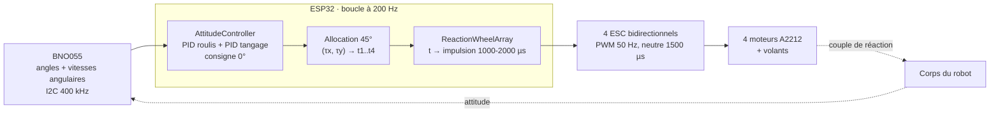

# Firmware de stabilisation (ESP32)

Le projet de référence est [`stabilisation/`](stabilisation/) : un projet PlatformIO pour ESP32 (DOIT DevKit V1, framework Arduino). Il réunit la lecture du capteur, le correcteur, l'allocation sur 4 roues et la commande des variateurs. Les versions plus anciennes sont dans [`archive/`](archive/README.md), dans l'ordre chronologique.

## Architecture



| Bibliothèque | Rôle |
| --- | --- |
| `lib/IMU/GY_BNO055` | Driver du BNO055 écrit directement sur les registres I2C : mode de fusion NDOF, angles d'Euler, quaternion, gyromètre, état de calibration |
| `lib/ESC/ESCMotor` | Commande d'un ESC par le périphérique LEDC de l'ESP32 : armement au neutre, impulsion bornée, retour au neutre si la commande s'arrête (failsafe à 500 ms) |
| `lib/RW/ReactionWheelArray` | Regroupe les 4 ESC : conversion d'une commande u ∈ [-1, 1] en impulsion autour du neutre, inversion de sens par roue |
| `lib/CTRL/AttitudeController` | Deux PID (roulis, tangage) avec amortissement par le gyromètre, saturation, allocation à 45°, coupure de sécurité au-delà de 45° |

## Deux programmes dans le même projet

| Environnement | Fichier | Usage |
| --- | --- | --- |
| `esp32doit-devkit-v1` (par défaut) | `src/main.cpp` | Version complète à 4 roues |
| `test_single_axis` | `src/test_single_axis.cpp` | Phase 1 du [plan TRL4](../docs/05-plan-trl4.md) : un axe, un moteur |

```bash
cd firmware/stabilisation
pio run -e esp32doit-devkit-v1 -t upload                 # version 4 roues
pio run -e test_single_axis -t upload -t monitor          # test sur un axe
```

## Conception temps réel (test sur un axe)

Le PID de stabilisation est du temps réel souple : un retard isolé ne fait pas tomber le robot, mais des retards répétés font accumuler de l'erreur. Le test sur un axe applique donc trois règles :

- **Période garantie par l'ordonnanceur.** La boucle est cadencée par `vTaskDelayUntil()` de FreeRTOS (5 ms, soit 200 Hz), au lieu d'une attente active sur `micros()`. La période ne dérive pas, même si une itération est plus longue.
- **Dépassements comptés, jamais ignorés.** Chaque itération mesure son temps de calcul ; s'il dépasse la période, un compteur `overruns` est incrémenté et publié.
- **Télémétrie exploitable en direct.** Toutes les 100 ms, une ligne JSON (`angle`, `rateDps`, `u`, `pulseUs`, `loopWorkUs`, `overruns`) est envoyée sur le port série, au format du plugin Serial Port de [PlotJuggler](https://github.com/facontidavide/PlotJuggler).

## Sécurités

- Armement : les ESC restent au neutre pendant 2,5 s au démarrage.
- Failsafe : retour au neutre si aucune commande pendant 500 ms.
- Capteur : neutre immédiat si une lecture du BNO055 échoue.
- Angle limite : coupure au-delà de 45° (version 4 roues) ou 30° (test sur un axe), et remise à zéro de l'intégrale.

## Points connus, à traiter avant les essais sur banc

Relevés en relisant le code pour ce dépôt.

1. **Conflit de broches dans `main.cpp`.** Les ESC 3 et 4 sont affectés aux broches 21 et 22, qui sont aussi le SDA et le SCL du bus I2C du BNO055. Les broches des ESC sont à réaffecter avant l'essai à 4 roues. Le test sur un axe n'est pas concerné (ESC sur la broche 18).
2. **Échelle de l'allocation.** `mix45_()` utilise k = 1 / (2 cos 45°), soit le double de la pseudo-inverse ([docs/03](../docs/03-architecture-4-roues.md)) : les signes sont justes, mais le couple appliqué vaut deux fois le couple demandé. C'est absorbé par les gains, mais à corriger pour que les gains aient un sens physique.
3. **Unités du PID.** Le terme proportionnel travaille en degrés et le terme dérivé en rad/s. À homogénéiser avant d'identifier des gains.
4. **Axes du gyromètre.** Le code associe le gyromètre x au roulis et y au tangage. À vérifier sur banc selon l'orientation de montage du BNO055.
5. **Cadence réelle de l'actionneur.** Les ESC sont commandés en PWM de modélisme à 50 Hz : la commande ne change réellement que toutes les 20 ms, même si la boucle tourne à 200 Hz. Des ESC acceptant un protocole plus rapide lèveraient cette limite.
6. **Pas de mesure de vitesse des volants.** Commande en boucle ouverte : la saturation d'un volant n'est pas détectable.
7. **Boucle de `main.cpp`.** Elle utilise encore une attente active sur `micros()` ; à passer sur `vTaskDelayUntil()` comme le test sur un axe.
