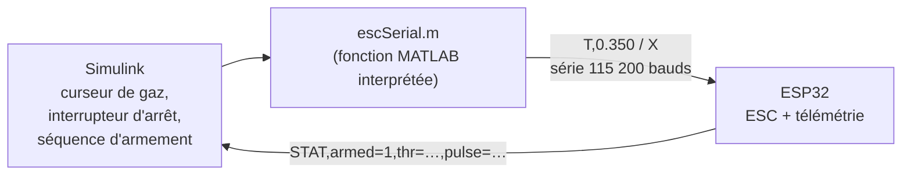

# Outils MATLAB et Simulink (janvier 2026)

Ces modèles servent à **piloter et caractériser les moteurs depuis le PC**, sans recompiler le firmware à chaque essai. Ils fonctionnent avec le firmware [`firmware/archive/2026-01_pilotage-esc-serie/`](../firmware/archive/README.md) chargé sur l'ESP32.

## `pilotage-esc/` : commander un ESC depuis Simulink

| Fichier | Rôle |
| --- | --- |
| `escSerial.m` | Envoie la consigne de gaz (`T,x`) ou l'arrêt (`X`) sur le port série. Limite l'envoi à 20 Hz et renvoie la consigne toutes les 200 ms (keep-alive), pour ne pas déclencher le failsafe de l'ESP32 (500 ms) quand le curseur ne bouge pas. L'arrêt est prioritaire. |
| `esc_motorS.slx` | Tableau de bord : curseur de gaz, interrupteur manuel, sous-système d'armement du moteur, affichages |
| `ESC_Motor.slx` | Version simplifiée : consigne de gaz et signal d'arrêt vers `escSerial` |
| `esc_motor.mlx` | Script de test pas à pas de la liaison série (envoi d'une consigne, lecture des réponses, arrêt) |

Avant usage : régler le port (`PORT = "COM8"` dans `escSerial.m`) sur celui de l'ESP32.

## `reception-consigne/` : côté cible

| Fichier | Rôle |
| --- | --- |
| `bldc_model.slx` | Modèle de réception d'une consigne par liaison série (bloc UART Receive) : décodage, validation de la trame, saturation, sortie `throttle` et indicateur `valid` |

## Pour aller plus loin

Pour comprendre la commande d'un moteur brushless (force contre-électromotrice, onduleur triphasé, commutation, MLI), je me suis appuyé sur la série de modèles MathWorks [*Design motor controllers with Simscape Electrical*](https://github.com/mathworks/Design-motor-controllers-with-Simscape-Electrical). Ces modèles appartiennent à MathWorks et ne sont pas copiés ici.

Fichiers enregistrés avec MATLAB et Simulink R2025b.
