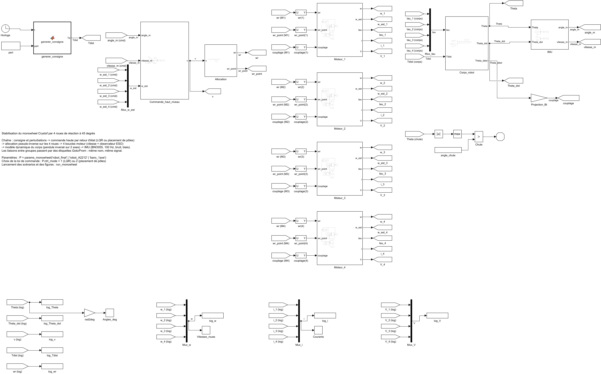
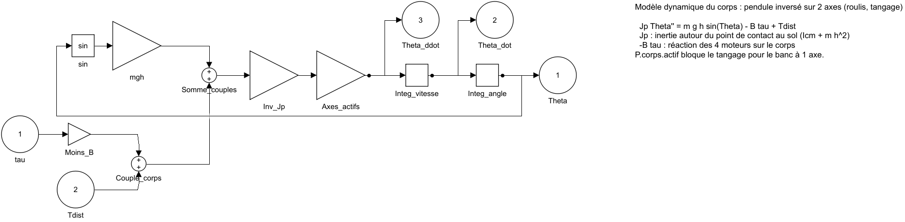
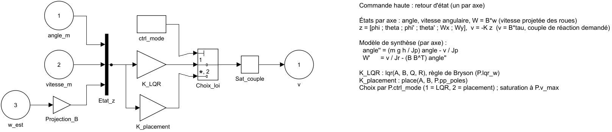
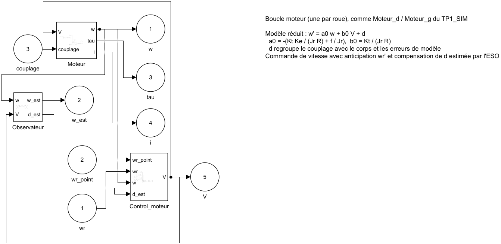
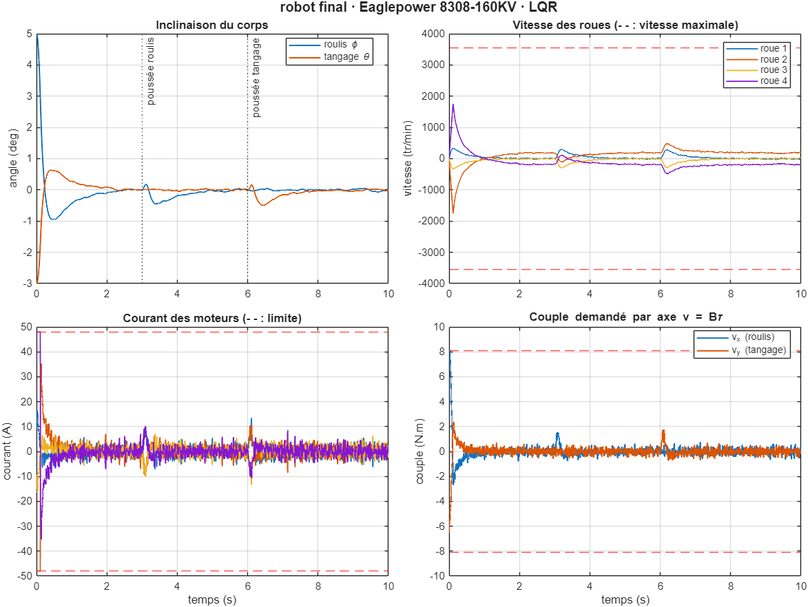
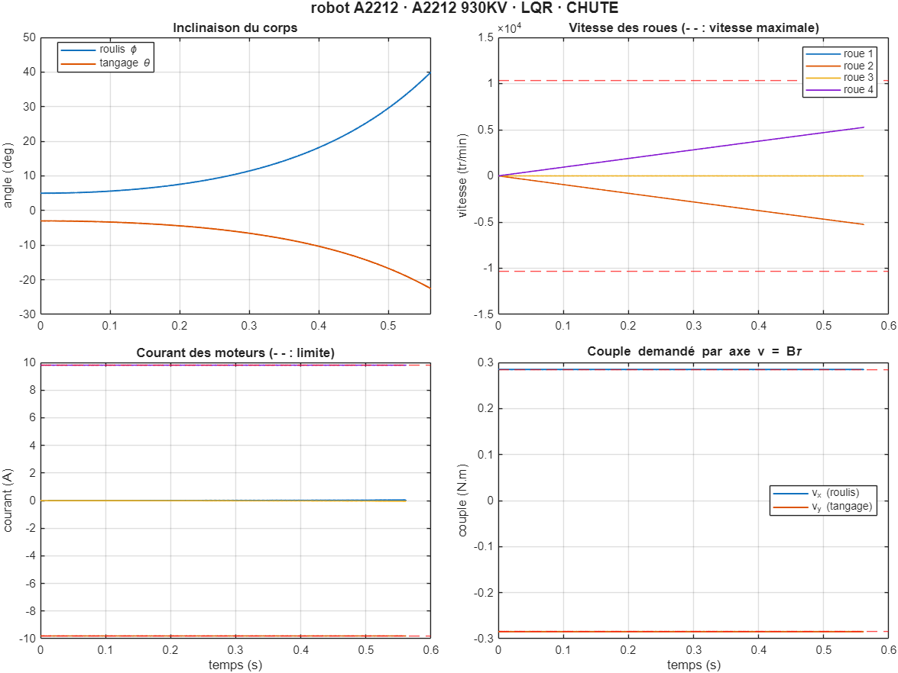
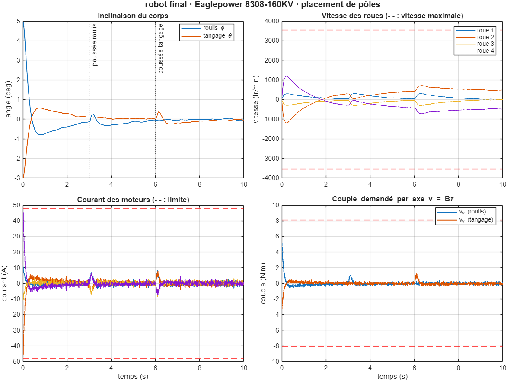
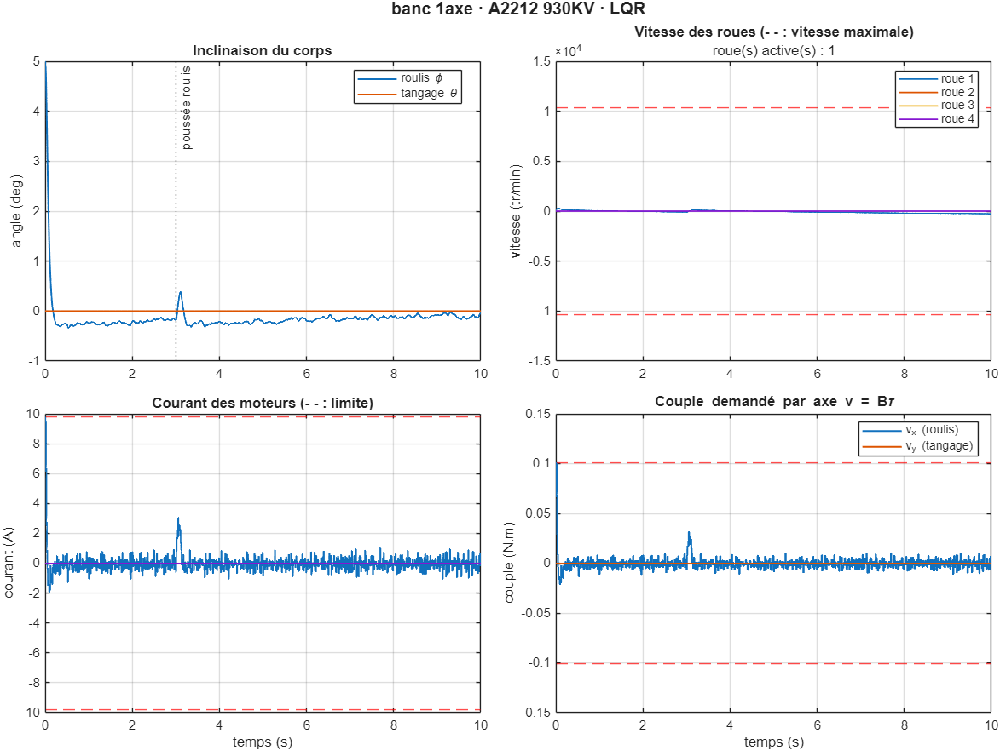

# Modèle Simulink : stabilisation du monowheel par retour d'état

**Le modèle `monowheel_rw.slx` stabilise le robot final de 6,5 kg avec 4 moteurs Eaglepower : il revient de 5° à moins de 1° en 0,18 s (LQR) et encaisse des poussées de 1 N·m. Avec les 4 moteurs A2212 achetés, le même robot tombe en 0,56 s. Le banc à un axe de la phase 1, lui, fonctionne avec un seul A2212.**

Version 1 du 17/10/2026 · MATLAB et Simulink R2025b (Control System Toolbox pour `lqr` et `place`).

## Utilisation

```matlab
cd simulation
build_monowheel_model          % construit monowheel_rw.slx (à refaire seulement si le script change)
run_monowheel                  % 3 configurations × 2 lois de commande, figures dans resultats/
```

Pour une simulation à la main : `P = params_monowheel('banc_1axe'); P.ctrl_mode = 2;`, puis ouvrir `monowheel_rw.slx` et cliquer sur Run. Sans `P` dans l'espace de travail, le modèle charge la configuration `robot_final`.

| Fichier | Rôle |
| --- | --- |
| [`params_monowheel.m`](params_monowheel.m) | Physique des trois configurations, gains de l'ESO, gains LQR et de placement de pôles |
| [`build_monowheel_model.m`](build_monowheel_model.m) | Construit le modèle bloc par bloc, avec les annotations d'équations dans chaque sous-système |
| [`run_monowheel.m`](run_monowheel.m) | Lance les scénarios, calcule les indicateurs, trace les figures |
| `monowheel_rw.slx` | Le modèle Simulink |

## Architecture : la même que mon TP de robot mobile (TP1_SIM)



| TP1_SIM (robot différentiel) | monowheel_rw (roues de réaction) | Rôle |
| --- | --- | --- |
| `generer_trajectoire` | `generer_consigne` | Consigne (verticale) et poussées calibrées sur le corps |
| `Commande_haut_niveau` | `Commande_haut_niveau` | Retour d'état sur l'angle, la vitesse angulaire et la vitesse des roues |
| `Convertisseur` | `Allocation` | Répartit le couple demandé sur les 4 roues : consignes `wr` et `wr_point` |
| `Moteur_d`, `Moteur_g` | `Moteur_1` à `Moteur_4` | Modèle réduit, commande de vitesse avec anticipation, observateur ESO |
| `Modèle_cinématique` | `Corps_robot` + `IMU` | Pendule inversé sur 2 axes, puis capteur BNO055 à 100 Hz |

Les liaisons entre groupes passent par des étiquettes Goto/From, comme les tags `Xr`, `w_d` ou `th` du TP : même nom, même signal.

### Corps du robot : pendule inversé sur 2 axes

Avec Θ = (φ, θ) le roulis et le tangage, et τ le couple des 4 moteurs sur leurs roues :

$$
J_p\,\ddot\Theta = m\,g\,h\,\sin\Theta - B\,\tau + T_{dist}
\qquad
B = \cos 45^\circ \begin{pmatrix} 1 & -1 & -1 & 1\\ 1 & 1 & -1 & -1\end{pmatrix}
$$

J_p est l'inertie autour du **point de contact au sol** (I_cm + m h² = 0,607 kg·m² pour le robot final). La [note de dimensionnement](../docs/02-dimensionnement.md) utilisait l'inertie au centre de masse (0,237 kg·m²). Le couple d'inertie y est donc sous-estimé, mais la gravité reste dominante.



### Commande haute : retour d'état

Grâce à l'allocation, chaque axe se commande séparément. Avec v = Bτ le couple de réaction demandé et W = Bw la vitesse des roues projetée sur l'axe :

$$
\ddot\varphi = \frac{m g h}{J_p}\,\varphi - \frac{v_x}{J_p}
\qquad
\dot W_x = \frac{v_x}{J_r} - (BB^T)_{xx}\,\ddot\varphi
\qquad
v = -K\,z
$$

L'état par axe est (angle, vitesse angulaire, W). Mettre la vitesse des roues dans l'état ramène les volants vers zéro : sans ce terme, ils accéléreraient jusqu'à saturer.

- **LQR** : `lqr(A, B, Q, R)`, avec des pondérations par la règle de Bryson (3° sur l'angle, 0,5 rad/s, 60 % de la vitesse maximale des roues, 3 N·m de couple).
- **Placement de pôles** : `place(A, B, p)`, avec p = (−6, −9, −0,8) pour le robot.
- Le bloc `ctrl_mode` choisit la loi : 1 pour la LQR, 2 pour le placement de pôles.



### Allocation et boucles moteur

L'allocation calcule τ_r = B⁺ v (pseudo-inverse, norme minimale), puis les consignes de vitesse wr = ∫ τ_r / J_r et leur dérivée wr_point = τ_r / J_r. Chaque moteur suit sa consigne avec la structure de mon TP :

$$
\dot w = a_0 w + b_0 V + d
\qquad
V = \frac{-K_v (w - w_r) - a_0 w - \hat d + \dot w_r}{b_0}
$$

La perturbation d regroupe le couplage avec le corps (le volant voit l'accélération du corps) et les erreurs de modèle. L'observateur ESO l'estime, avec des pôles en −150 et −200. Le moteur simulé limite aussi le courant à celui de l'ESC (48 A pour l'Eaglepower, 9,8 A pour l'A2212).



### IMU

BNO055 en mode fusion, échantillonné à 100 Hz, avec un bruit de 0,1° sur l'angle, de 0,1 °/s sur la vitesse angulaire, et un biais de verticale de 0,2°.

## Configurations

| Paramètre | `robot_final` | `robot_A2212` | `banc_1axe` |
| --- | --- | --- | --- |
| Corps | 6,5 kg, centre de masse à 25 cm, J_p = 0,607 kg·m² | Identique | Pendule de 0,25 kg (H), 8 cm (H), J_p = 0,0025 kg·m² (H) |
| Roues | 4 à 45° | 4 à 45° | 1, alignée avec le roulis ; tangage bloqué |
| Moteur | Eaglepower 8308-160KV, 6S, 48 A | A2212 930KV, 3S, 9,8 A | A2212 930KV, 3S, 9,8 A |
| Volant (J_r) | 0,25 kg à 80 mm : 1,7·10⁻³ kg·m² | Disque PLA de 30 g : 1,0·10⁻⁴ kg·m² | Identique |
| Couple maximal par axe | 8,1 N·m | 0,28 N·m | 0,10 N·m |
| Scénario | 5° et −3° au départ, poussées de 1 N·m pendant 0,1 s à 3 s et 6 s | Identique | 5° au départ, poussée de 0,02 N·m à 3 s |

(H) : hypothèse à mesurer. La résistance des moteurs (0,1 Ω), l'inertie des rotors et les frottements sont aussi des hypothèses.

## Résultats

| Configuration | Loi | Chute | Retour sous 1° | Vitesse max des roues | Courant max | Temps en limite de courant |
| --- | --- | --- | --- | --- | --- | --- |
| robot_final | LQR | non | 0,18 s | 1 744 tr/min | 48 A | 1,2 % |
| robot_final | placement de pôles | non | 0,29 s | 1 191 tr/min | 48 A | 0,2 % |
| robot_A2212 | LQR | **oui, en 0,56 s** | | 5 252 tr/min | 9,8 A | 100 % |
| robot_A2212 | placement de pôles | **oui, en 0,56 s** | | 5 252 tr/min | 9,8 A | 100 % |
| banc_1axe | LQR | non | 0,11 s | 288 tr/min | 9,8 A | 0,2 % |
| banc_1axe | placement de pôles | non | 0,13 s | 257 tr/min | 9,4 A | 0 % |

<p align="center">
  
  
</p>
<p align="center">
  
  
</p>

Ce que montrent ces simulations :

1. **Le dimensionnement initial fonctionne.** Avec les Eaglepower, le robot se redresse et rejette les poussées. Le courant n'atteint la limite de 48 A qu'au départ, pendant environ 0,1 s, pour rattraper les 5° initiaux.
2. **L'A2212 ne peut pas tenir le robot final.** Les deux axes restent saturés à 0,28 N·m alors que la gravité demande 1,4 N·m à 5° : la loi de commande n'y change rien. C'est la confirmation, en simulation, de la [revue du budget de couple](../docs/04-revue-budget-de-couple.md) de septembre.
3. **Le banc à un axe est réaliste avec le matériel actuel.** Un seul A2212 redresse le pendule en 0,11 s, et une poussée ne demande que 3 A.
4. **LQR ou placement de pôles : un compromis.** La LQR est plus rapide et ramène mieux les roues vers zéro. Le placement de pôles demande des gains plus faibles, donc il amplifie moins le bruit de l'IMU (ondulation de courant d'environ ±2 A contre ±5 A).
5. **Le biais de l'IMU se paie en vitesse de roue.** Avec 0,2° d'erreur de verticale, les volants gardent une vitesse résiduelle de quelques centaines de tr/min. Une calibration soignée de la verticale limite ce point.

## Limites du modèle

- **Petits angles.** Les deux axes sont découplés, ce qui est valable sous une quinzaine de degrés. Au-delà, il faudrait un modèle 3D (Simscape Multibody est installé).
- **Mesure de la vitesse des roues.** La commande utilise la vitesse des roues, mais les ESC actuels n'en renvoient aucune. Sur le vrai robot, il faudra une télémétrie d'ESC ou un capteur.
- **Commande continue.** Les correcteurs sont simulés en temps continu. Le firmware tourne à 200 Hz et commande les ESC en PWM à 50 Hz : à discrétiser pour une validation plus fidèle.
- **Paramètres moteur supposés.** La résistance, les inerties et les frottements sont à mesurer ; les outils de caractérisation de [`matlab/pilotage-esc/`](../matlab/README.md) peuvent servir à les identifier.
- **Roue au sol absente.** Le robot reste sur place : pas de déplacement ni de modèle cinématique.

## Prochaines étapes proposées

1. Mesurer sur le banc la masse, la position du centre de masse et l'inertie du pendule, puis mettre à jour `banc_1axe`.
2. Discrétiser la commande à 200 Hz et la sortie vers les ESC à 50 Hz, pour retrouver les conditions du firmware.
3. Transcrire le gain retenu dans [`test_single_axis.cpp`](../firmware/stabilisation/src/test_single_axis.cpp), à la place des gains PID actuels, une fois validé en simulation discrète.
4. Ajouter la roue au sol et le modèle cinématique (x, y, cap) quand le moteur de propulsion sera choisi.
