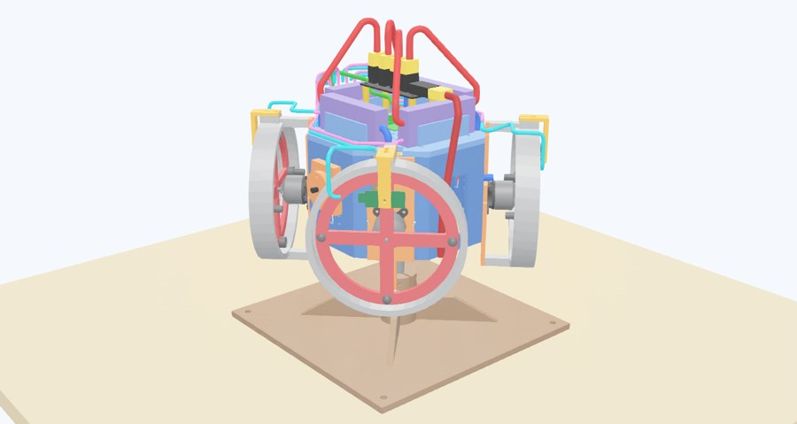

# Jumeau numérique du banc de stabilisation (version 3)

Un seul modèle Simulink commande le banc, et deux jumeaux numériques interchangeables tiennent la place du banc réel :
un jumeau **Simscape** (calculé dans Simulink) et un jumeau **Webots** (calculé par Webots, vue 3D).
Les deux sortent de la même CAO et reçoivent tous leurs réglages de MATLAB.

Toute la chaîne est construite : **référence** (programmée ou donnée par un manche), **commande haut niveau** (une
boucle par axe, avec observateur CFO), **conversion** (couples des axes vers les 4 roues), **commande bas niveau** (une
boucle de vitesse par roue, avec observateur CFO), **procédé** et **perception**. Le banc de la CAO est **équilibré** :
son centre de masse est sur le pivot, il tient n'importe quelle inclinaison. Une **interface de pilotage** (`pilote_banc`)
le commande comme une manette de drone.



## Organisation du dossier

| Élément | Contenu |
| --- | --- |
| `Mode-emploi_jumeau-numerique.html` | Le mode d'emploi complet (copie hors ligne du manuel publié), à ouvrir dans un navigateur. |
| `jumeau_banc_rw.slx` | Le modèle à ouvrir. Référence, commande, pupitre, procédé à variantes, perception, interface de pilotage. Paramètres dans son Model Workspace. |
| `pilotage/pilote_banc.m` | L'interface de pilotage : manche, poussées, choix du jumeau, état du banc en direct. Taper `pilote_banc` dans MATLAB. |
| `pilotage/pilotage_banc.m` | L'échange entre l'interface et le modèle. |
| `geometrie/` | Les 40 pièces de la CAO en STL, utilisées par les deux jumeaux. |
| `liaison/pont_banc.m` | La liaison entre Simulink et le procédé distant (Webots aujourd'hui, ESP32 demain). |
| `webots/worlds/banc_stabilisation.wbt` | Le monde Webots : 124 pièces, les mêmes corps et les mêmes liaisons que Simscape. |
| `webots/controllers/pont_simulink/` | Le contrôleur Python de Webots : il reçoit les trames de Simulink et calcule ESC, moteurs et capteurs. |
| `construction/` | Ce qui fabrique le procédé à partir de la CAO, puis pose la commande, la perception et le pilotage dans le modèle. |
| `verification/` | Les essais joués sur les deux jumeaux : procédé, commande bas niveau, commande complète. |

## Piloter le banc

1. Pour voir le banc dans Webots : ouvrir `webots/worlds/banc_stabilisation.wbt` dans Webots R2025a et attendre
   « jumeau Webots prêt ». Pour le jumeau Simscape, rien à ouvrir.
2. Dans MATLAB : `cd` dans `jumeau_numerique/pilotage`, puis `pilote_banc`. Le modèle se charge.
3. Choisir le jumeau, puis **Démarrer**. Le banc est tenu 2 s, puis la commande le prend en main.
4. Pousser le manche (souris, doigt sur un écran tactile, ou flèches du clavier) : vu de dessus, le banc penche du côté
   où l'on pousse. Lâché, le manche revient au centre, sauf si « Garder l'inclinaison » est coché.
5. Les boutons « Côté +X », « Côté −Y »… appuient brièvement sur un côté du banc, comme avec le doigt.
6. **Arrêter**, ou fermer la fenêtre.

Lancée par l'interface, la simulation est calée sur l'horloge par `pilotage_banc` : 0,99 fois le temps réel avec le jumeau
Simscape sur ce PC (le rythme de Simulink, lui, la ralentissait à 0,8 fois).

La simulation peut aussi être lancée depuis Simulink (Run) : tant que l'interface est ouverte, le manche pilote la
référence. Interface fermée, la référence programmée (`ref_t`, `ref_roulis_deg`, `ref_tangage_deg`) s'applique.

## Architecture du modèle

Le niveau haut suit le cours de robotique avancée :

```text
Référence → Commande haut niveau → Conversion → Commande bas niveau → Pupitre → PROCÉDÉ → Interface sensorielle → Perception
    ▲              ▲                                  ▲                  │          ▲                                    │
  manche           └──────────────────────────────────┴───────── état ◄──┼──────────┼────────────────────────────────────┘
(interface)                                                               └── imp ──►┘ (vers la Perception)
                                                              poussée d'essai ──────►┘
```

| Bloc | Rôle | État |
| --- | --- | --- |
| Interface de pilotage | Lit le manche et les poussées de l'interface `pilote_banc` | Fait |
| Référence | Angles demandés : programmés en polynômes de degré 5, ou donnés par le manche | Fait |
| Commande haut niveau | Stabilisation de l'inclinaison : une boucle par axe avec observateur CFO, sortie en couples sur les deux axes | Fait |
| Conversion | Répartition des couples des deux axes sur les 4 roues. Sortie : vitesse et accélération demandées à chaque roue | Fait |
| Commande bas niveau | Boucle de vitesse de chaque roue avec observateur CFO, sortie en impulsions d'ESC | Fait |
| Pupitre | 4 curseurs d'ESC (1300 à 1700 µs), échelon d'essai, interrupteurs manuel/commande et marche/arrêt | Fait |
| Poussée d'essai | Poussée programmée plus poussées de l'interface, envoyée au procédé | Fait |
| Procédé | Le banc : jumeau Simscape ou jumeau Webots, plus tard le banc réel | Fait (deux jumeaux) |
| Interface sensorielle | Ce que l'ESP32 lit : registres du BNO055, vitesses des 4 roues | Fait |
| Perception | État du banc : angles, vitesses, roues avec leur signe, moment cinétique, déséquilibre, réserve | Fait |
| Tableau de bord | Envoie l'état du banc à l'interface, 10 fois par seconde | Fait |

Le procédé a toujours la même interface, celle du banc réel :

- **entrée** : 4 impulsions d'ESC en microsecondes ;
- **sorties** : les registres du BNO055 (angles d'Euler, gyroscope, quaternion, accéléromètre) et les 4 vitesses de roue
  mesurées par les TCRT5000 ;
- pour les jumeaux seulement : une seconde entrée, la poussée d'essai (N·m), et les grandeurs réelles que le banc ne
  mesure pas (angles du cardan, courants, couples, tensions).

Dans les deux jumeaux, la chaîne est la même : ESC (trame de 20 ms, armement, rapport cyclique) → moteur A2212
(modèle équivalent continu) → mécanique de la CAO (cardan à 2 axes avec butées, 4 roues) → BNO055 et TCRT5000.

Les liaisons longues sont remplacées par des Goto et From, dont l'étiquette porte le nom du signal.

## Équilibrage du banc

Le centre de masse du dispositif était 3,6 mm au-dessus du pivot et 0,65 mm de côté : le banc avait un point
d'équilibre imposé (10° de tangage au pivot +24) et ne pouvait tenir un autre angle que quelques secondes. La CAO
(sources Python du banc de stabilisation, dossier `Banc_stabilisation/sources`) le corrige de deux façons :

- **Hauteur** : les paliers de tangage ont des lumières verticales de ±4 mm autour de chaque rangée d'inserts. Le pivot
  se monte à **+25 mm** (rangée +24, paliers remontés de 1 mm) : il est alors à la hauteur du centre de masse.
- **Côté** : 4 tiges filetées M6 × 60 sortent des faces ±X et ±Y, 25 mm à côté du milieu de chaque face, à z = −20,
  serrées sur la paroi par un écrou de chaque côté. Des écrous M6 de réglage s'y vissent : leur nombre donne le réglage
  grossier, leur position le réglage fin. Réglage de la CAO : 3 écrous à 104,9 mm du centre sur la tige +X, 1 à 89,1 mm
  sur +Y, aucun sur −X, 2 à 103,6 mm sur −Y. À 25 mm (20 mm au départ), les écrous des tiges ±Y passent à 2,2 mm des
  paliers sur toute leur course (à 20 mm, ils les touchaient aux rangées basses) ; 2,3 mm entre le bout des tiges et les
  carters, 9,2 mm aux disques en rotation.

Résultat dans la CAO : centre de masse à 0,000 mm du pivot de côté et 0,003 mm en hauteur, pour 1 336 g de partie
mobile. Sur le banc réel, les masses différeront : la Perception mesure le déséquilibre restant en mm (voir plus bas),
c'est le réglage à reporter sur les écrous.

## Référence

Le bloc donne l'angle, la vitesse et l'accélération demandés sur le roulis et sur le tangage.

- **Programme** : à chaque instant `ref_t(i)`, le dispositif part vers le palier `[ref_roulis_deg(i) ;
  ref_tangage_deg(i)]` et y arrive `ref_duree` plus tard, par un polynôme de degré 5.
- **Manche** : quand l'interface est ouverte et que le dispositif est lâché (`t_depart`), l'angle vient du manche,
  borné à `manche_max_deg` (15°), suivi par un second ordre critique de pulsation `w_manche` (3 rad/s) qui donne aussi
  la vitesse et l'accélération demandées.

## Perception

Elle n'utilise que ce que l'ESP32 lit (BNO055, TCRT5000) et les impulsions envoyées aux ESC. Les observateurs CFO
restent dans les commandes, comme dans le TP2 : la Perception leur donne des mesures propres.

| Bloc | Ce qu'il donne |
| --- | --- |
| Inclinaison x2 | Angles du cardan tirés du quaternion du BNO055 (pas de 2⁻¹⁴, contre 1/16° pour les angles d'Euler, et exacts quand roulis et tangage se combinent) ; vitesses de roulis et de tangage tirées du gyroscope |
| Vitesses des roues x4 | Vitesse de chaque roue avec son signe (le TCRT5000 ne le donne pas), et si le capteur la voit |
| Moment cinétique des roues x2 | H = J cos 45° [Σ sx ω ; Σ sy ω], sur le roulis et le tangage |
| Couple extérieur et déséquilibre x2 | Couple extérieur que les roues absorbent (dérivée filtrée de H), et position du centre de masse par rapport au pivot, en mm |
| Réserve des roues | De 1 (roues à leur vitesse de repos) à 0 (une roue à sa limite) |

- **Angles** : la verticale vue par le capteur se tire du quaternion ; vue par le dispositif, elle vaut
  [−cos φ sin θ ; sin φ ; cos φ cos θ] pour un roulis φ et un tangage θ. Le cap du capteur n'intervient pas.
- **Vitesses** : le gyroscope vu par le dispositif vaut [cos θ dφ/dt ; dθ/dt ; sin θ dφ/dt].
- **Signe des roues** : un modèle de chaque roue, calculé avec la tension tirée des impulsions envoyées. Il ne reçoit pas
  la mesure : une erreur de signe ne peut pas s'entretenir. Sous `w_aveugle` (45 rad/s), la roue n'est pas vue.
- **Déséquilibre** : quand le dispositif est immobile, la pesanteur fait un couple m g d, avec d le décalage horizontal
  du centre de masse. Les roues l'absorbent : dH/dt = couple. D'où d = [couple de tangage ; −couple de roulis] / (m g),
  filtré par un premier ordre de 2 s (`tau_desequilibre`). Juste quand le dispositif est immobile et sans poussée.

## Commande haut niveau

Une boucle par axe, selon le TP2 (placement de pôles basé sur l'observateur CFO), sans adaptation. Chaque signal porte
les 2 axes `[roulis ; tangage]`.

| Bloc | Rôle |
| --- | --- |
| Référence et désaturation x2 | Passe la référence en radians et peut la décaler pour ramener les roues à leur vitesse de repos |
| Mesures x2 | Angles et vitesses donnés par la Perception, lus toutes les 20 ms |
| CFO x2 | Estime l'angle, la vitesse et la perturbation de chaque axe |
| Loi de commande x2 | Calcule le couple demandé aux roues sur chaque axe |
| Limite et mise en marche x2 | Borne le couple à `C_max` et ne laisse passer la commande qu'à partir de `t_depart` |

- **Modèle local d'un axe** : d²θ/dt² = −a1 dθ/dt + a0 C + d, avec C le couple demandé aux roues, a0 = 1 / I et
  a1 = b_cardan / I. La perturbation d regroupe la pesanteur, le décalage du centre de masse, les couplages et les
  poussées.
- **CFO** : dθ̂/dt = ω̂, dω̂/dt = −a1 ω̂ + a0 C + Le + z3, dz3/dt = λ Le, d̂ = Le + z3, avec
  Le = l2 (θ − θ̂) + l1 (ω − ω̂), l1 = 9 ωo, l2 = 12 ωo², λ = 4/3 ωo.
- **Loi de commande** : C = (−k1 (θ̂ − θr) − k2 (ω̂ − dθr/dt) − d̂ + a1 dθr/dt + d²θr/dt²) / a0, avec k1 = ωc² et
  k2 = 2 ξ ωc − a1.
- **Désaturation** (`desat_active`, 0 par défaut) : la référence est décalée de `k_desat` fois le moment cinétique des
  roues mesuré par la Perception. Le dispositif se penche et la pesanteur rend aux roues leur vitesse de repos. Elle ne
  sert qu'à un banc déséquilibré (pivots +16 à −8) : sur le banc équilibré, se pencher ne décharge plus les roues.
- **Période** : 20 ms, comme la commande bas niveau.

Réglages : `wc_axe` (4 rad/s), `xi_axe` (1), `wo_axe` (3 rad/s), `desat_active`, `T_desat` (5 s), `t_depart`.

## Conversion

Une roue qui accélère pousse le dispositif en sens inverse. Les roues sont à 45°, 135°, 225° et 315° : chacune agit sur
les deux axes à part égale. L'accélération demandée aux 4 roues vaut `M_conv` fois `[couple de roulis ; couple de
tangage]`, soit −(sx Cx + sy Cy) / (4 J cos 45°) pour chaque roue. Elle est bornée à `acc_roue_max`, intégrée, puis
ajoutée à la vitesse de repos `w_repos`.

Les 4 roues tournent toujours à `w_repos` (200 rad/s) : deux roues opposées tournent en sens contraire et leurs effets
s'annulent, et aucune roue ne passe par l'arrêt, où le TCRT5000 ne la voit plus. La vitesse demandée reste entre
`w_roue_min` et `w_roue_max` (60 et 400 rad/s).

## Commande bas niveau

Une boucle de vitesse par roue, selon la méthode du TP2, ramenée d'un ordre : on commande une vitesse, pas une
position. Chaque signal porte les 4 roues, et chaque réglage est un vecteur de 4 valeurs.

| Bloc | Rôle |
| --- | --- |
| + consigne d'essai | Ajoute à la consigne de la conversion deux paliers de vitesse reliés par des rampes |
| CFO x4 | Estime la vitesse et la perturbation de chaque roue, à partir de la vitesse avec signe donnée par la Perception |
| Loi de commande x4 | Calcule la tension de chaque moteur |
| Interface tension - impulsion x4 | Convertit la tension en impulsion d'ESC, bornée et arrondie à 1 µs |

- **Modèle local d'une roue** : dω/dt = −a1 ω + a0 V + d, avec a0 = Kt / (R J) = 546 rad/s² par volt et
  a1 = (Kt Ke / R + f) / J = 3,76 s⁻¹.
- **CFO** : dω̂/dt = −a1 ω̂ + a0 V + Le + z, dz/dt = λ Le, d̂ = Le + z, avec Le = l1 (ω mesurée − ω̂),
  l1 = 5 ωo et λ = 4/5 ωo. Quand la roue n'est pas vue, le CFO ne se corrige plus et z revient vers 0.
- **Loi de commande** : V = (−K (ω̂ − ωr) − d̂ + a1 ωr + dωr/dt) / a0, avec K = ωc − a1.
- **Interface** : impulsion = neutre + sens × V × 500 / V_alim, bornée de 1375 à 1625 µs.
- **Période** : 20 ms, celle des ESC.

Réglages : `wc_roue` (10 rad/s), `wo_roue` (5 rad/s), `w_aveugle`, `imp_cmd_min`, `imp_cmd_max`, consigne d'essai
`essai_roue_...` (vide par défaut). Pour essayer les roues seules : `t_depart = 1e9`, `w_repos = 0`,
`w_roue_min = -400`, `blocage_roulis` et `blocage_tangage` à 1, puis une consigne dans `essai_roue_vitesse1`.

## Essais : tenue au départ et poussée

- **Tenue à la main** : jusqu'à `t_lacher` (2 s), un ressort amorti (`k_main`, `c_main`) garde le dispositif à sa position
  de départ, dans les deux jumeaux. Pendant ce temps, les ESC s'arment et les roues montent à leur vitesse de repos.
- **Poussée** : le bloc « Poussée d'essai » envoie au procédé la poussée programmée (`perturbation_t`,
  `perturbation_duree`, `perturbation_couple`) plus celles de l'interface. Le jumeau Webots la reçoit dans sa trame de
  commande.

## Lancer une simulation sans l'interface

Le modèle s'ouvre sur le jumeau choisi au dernier enregistrement. Pour en changer : clic droit sur le bloc Procédé,
Variant, Label Mode Active Choice. Avec Webots : ouvrir d'abord le monde et attendre « jumeau Webots prêt ». Puis Run.
Webots avance au rythme de Simulink, une trame toutes les 10 ms, et attend le lancement suivant à la fin.

Tous les réglages sont dans le Model Workspace du modèle (Model Explorer, `jumeau_banc_rw`, Model Workspace), puis
« Reinitialize from source ». Les principaux : `pivot_mm` (25, 24, 16, 8, 0 ou −8), `blocage_roulis`,
`blocage_tangage`, `angle0_roulis_deg`, `angle0_tangage_deg`, `t_lacher`, `ref_...`, `perturbation_...`, `bruit_bno`.
Webots n'a aucun réglage à lui : au lancement, MATLAB lui envoie 51 valeurs, y compris la position du pivot.

## Comment MATLAB commande tout

MATLAB calcule la commande et n'envoie qu'une chose : une trame de 4 impulsions d'ESC. Ce qui est au bout de la liaison
exécute. Aujourd'hui c'est Webots, demain l'ESP32, qui transmettra les impulsions aux ESC et donc aux moteurs.

| Trame | Sens | Contenu |
| --- | --- | --- |
| Commande (13 octets) | MATLAB vers procédé | `A5 5A`, 4 impulsions en µs (entiers 16 bits), drapeaux (bit 0 : marche), numéro, somme de contrôle |
| Commande du jumeau (21 octets) | MATLAB vers Webots | Les 12 premiers octets ci-dessus, la poussée d'essai (2 nombres en simple précision, N·m), la somme |
| Télémétrie (51 octets) | Procédé vers MATLAB | `B5 5B`, temps en ms, état d'armement, numéro, registres du BNO055, 4 vitesses de roue, somme de contrôle |
| Grandeurs réelles (100 octets) | Jumeau Webots seulement | Angles et vitesses du cardan, vitesses, courants, couples, tensions, rapports cycliques, courant d'alimentation |

Ports locaux : 5007 (réglages, au lancement), 5006 (commande), 5005 (télémétrie).

Pour le banc réel, il restera à ajouter une troisième variante du procédé, « Banc réel », qui utilise les trames de
l'ESP32, et à écrire le firmware de l'ESP32 qui les lit et les écrit. La commande, la Perception et l'interface ne
changeront pas.

## Ce qui a été vérifié

### Procédé

Script `verification/verifier_jumeaux.m` : chaque essai est joué sur les deux jumeaux avec les mêmes réglages, puis
comparé au calcul fait à partir de la CAO équilibrée.

| Essai | Jumeau Simscape | Jumeau Webots |
| --- | --- | --- |
| Chute libre en roulis, pivot +24 (centre de masse 0,94 mm au-dessus du pivot) : écart au pendule inversé jusqu'à 8° | 0,0001° | 0,0009° |
| Chute libre en roulis, pivot −8 (30,5 mm) | 0,0042° | 0,0200° |
| Roue 1 à 1600 µs, axes bloqués (calcul : 348,9 rad/s) | 348,7 rad/s | 348,6 rad/s |
| Constante de temps de la roue (calcul : 0,266 s plus le retard de trame) | 0,268 s | 0,269 s |
| Armement : 1600 µs dès la mise sous tension | la roue ne démarre pas | la roue ne démarre pas |
| Moment cinétique en roulis, sans pesanteur (écart) | 0,29 % | 0,52 % |
| BNO055 sans bruit, comparé au cardan | au pas de quantification | au pas de quantification |
| TCRT5000 en régime établi, comparé à la vitesse réelle | 0,16 rad/s | 0,19 rad/s |

Écart entre les deux jumeaux avant les butées : 0,001° à 0,125° sur les angles, 0,26 % sur la vitesse de roue.

### Commande bas niveau

Script `verification/verifier_commande_bas_niveau.m`, axes bloqués sauf mention contraire, commande haut niveau à l'arrêt.

| Essai | Jumeau Simscape | Jumeau Webots |
| --- | --- | --- |
| Roue 1 seule, 0 puis 150 rad/s puis 0 : erreur pendant les rampes (300 rad/s²) | 11,7 rad/s | 11,6 rad/s |
| Même essai : erreur sur le palier, puis à l'arrêt | 0,02 et 0,0 rad/s | 0,02 et 0,0 rad/s |
| Inversion de +150 à −150 rad/s : erreur pendant l'inversion | 12,6 rad/s | 13,3 rad/s |
| Modèle faux (moteur à 0,12 Ω, zone morte de 10 µs) : perturbation estimée (calcul : −133 rad/s²) | −133 rad/s² | −133 rad/s² |
| Même essai : erreur sur le palier (sans compensation : 13 rad/s) | 0,63 rad/s | 0,63 rad/s |
| Quatre roues ensemble : erreur sur les paliers | 0,64 rad/s | 0,64 rad/s |
| 500 rad/s demandés : impulsion bornée à 1625 µs, puis retour à 150 rad/s | 0,01 rad/s | 0,01 rad/s |

Écart entre les deux jumeaux sur la vitesse des roues : 1,8 à 4,4 rad/s au plus, pendant les rampes.

### Commande complète

Script `verification/verifier_commande_complete.m`. Banc équilibré (pivot +25) sauf mention contraire, axes libres, départ à (2° ; −1°), tenu jusqu'à 2 s. Le manche est remplacé par un scénario.

| Essai | Jumeau Simscape | Jumeau Webots |
| --- | --- | --- |
| Lâcher à 2 s : écart à la référence, de 2 à 7 s | 0,04° | 0,04° |
| Poussée de 0,02 N·m sur les deux axes : écart, puis 2 s après | 0,54° puis 0,02° | 0,52° puis 0,02° |
| Roulis de 5° demandé à 12 s : roulis à 20 s | 5,00° | 5,00° |
| Tenue de (10° ; −8°) avec une poussée de 0,03 N·m à 15 s : écart de 7 à 15 s, puis de 18 à 40 s | 0,04° et 0,05° | 0,04° et 0,05° |
| Même essai : dérive des roues de 18 à 40 s ; réserve à 40 s | 1,8 rad/s ; 79 % | 1,7 rad/s ; 79 % |
| Perception, même essai : angles (écart type, maximum) | 0,050°, 0,21° | 0,051°, 0,23° |
| Perception : signe des roues juste ; vitesse des roues au plus | 100 % ; 2,2 rad/s | 100 % ; 1,9 rad/s |
| Perception : moment cinétique des roues au plus | 4,0·10⁻⁴ N·m·s | 3,9·10⁻⁴ N·m·s |
| Poussée de 0,05 N·m sur le roulis : écart, retour à moins de 0,5° | 1,31°, en 0,3 s | 1,28°, en 0,3 s |
| Manche : (8° ; 0°), (8° ; −6°), puis (−10° ; 10°) atteints à | 0,01° près | 0,03° près |
| Manche : écart à la référence, hors poussée | 0,27° au plus | 0,17° au plus |
| Déséquilibre de 0,98 mm (rangée +24), tenue de (10° ; −8°) : centre de masse estimé, et réel | (−0,127 ; −0,154) mm, (−0,136 ; −0,161) mm | (−0,125 ; −0,152) mm, (−0,136 ; −0,161) mm |
| Même essai : roues à bout de réserve à | 21,8 s | 22,2 s |
| Pivot +8 (17 mm de déséquilibre), désaturation en marche : angles à 20 s ; butées | (−0,01° ; −0,01°) ; non touchées | (−0,01° ; −0,01°) ; non touchées |

Écart entre les deux jumeaux : 0,07° au plus sur les angles, 3,4 rad/s au plus sur les roues. Courbes : `verification/commande_complete.png`.

**Interface** : essayée en pilotant le jumeau Simscape (manche, poussée, arrêt, affichage, remise en état du modèle). Simulation lancée par l'interface : 0,99 fois le temps réel sur ce PC. Lancée par le bouton Run de Simulink, avec le rythme de Simulink : 0,8 fois.

## Ce qu'il faut savoir

- **Le banc équilibré tient n'importe quel angle, mais il ne se décharge plus tout seul.** Chaque poussée laisse aux roues
  un peu de moment cinétique (0,006 N·m·s pour 0,03 N·m pendant 0,2 s, environ 10 % de leur réserve). Plusieurs poussées
  dans le même sens finissent par amener une roue à sa limite. La réserve s'affiche dans l'interface. Pour la rendre,
  il faut un couple extérieur : laisser un léger déséquilibre et mettre la désaturation, ou arrêter et redémarrer.
- **Le banc réel ne sera pas équilibré au 1/100 de mm.** Avec 1 mm de déséquilibre (paliers non remontés), le banc tient
  10° pendant une vingtaine de secondes. La Perception mesure ce déséquilibre (à 0,01 mm près dans les jumeaux) : c'est
  le réglage des écrous à faire.
- **Les angles tirés du quaternion portent le même bruit que les angles d'Euler** (0,05° supposé) : le gain est le pas,
  8 fois plus fin, et l'exactitude en inclinaison combinée. Les jumeaux bruitent maintenant le quaternion comme les
  angles d'Euler.
- **Le CFO des axes est limité à ωo = 3 rad/s.** Au-delà de ωo = 4, le retard de la chaîne (commande à 20 ms, ESC à
  50 Hz) fait osciller le couple. Des ESC lus à 200 Hz lèveraient cette limite.
- **Le CFO d'une roue est une adaptation.** Le TP2 donne le CFO pour une position (ordre 2). Ici il est ramené à
  l'ordre 1. Les gains l1 = 5 ωo et λ = 4/5 ωo ne viennent pas du sujet.
- **Le passage d'une roue par zéro se fait à l'aveugle** (4 fronts par tour) ; la vitesse de repos de 200 rad/s l'évite.
- **Un échelon de 100 µs sur une roue arrêtée demande 29 A en pointe** avec la résistance supposée (0,08 Ω). Avec la
  commande, la pointe est de 15 A, à la mise en rotation des roues.
- **Les valeurs marquées (H) dans le Model Workspace sont des hypothèses** à mesurer sur le banc : résistance et
  inductance du moteur, frottements, butées, temps de réponse et zone morte des ESC, bruit du capteur, masses estimées.
- **L'interface ne pilote que pendant une simulation** lancée depuis elle ou depuis Simulink. Interface fermée, la
  référence programmée s'applique.
- Le jumeau Webots a été essayé sans affichage. La cadence avec l'affichage complet reste à constater à l'écran.
- La liaison utilise des connexions Java de MATLAB : la liaison TCP d'origine de MATLAB attendait 15,6 ms par trame.

## Reconstruire après un changement de CAO

Dans `construction/`, dans cet ordre :

1. `preparer_cao.py` (environnement build123d) : écrit `cao_jumeau.json` et les STL de `geometrie/`.
   `preparer_cao.py --equilibrer` calcule le réglage des écrous et la hauteur du pivot qui équilibrent le banc, à
   reporter dans `rw_params.py`.
2. `construire_simulink.m` (MATLAB) : écrit `jumeau_banc_rw.slx`, procédé seul.
3. `construire_commande_bas_niveau.m`, `construire_commande_haut_niveau.m`, `construire_perception.m`,
   `construire_pilotage.m` (MATLAB) : posent la commande, la Perception et le pilotage.
4. `construire_equilibrage.m` (MATLAB) : met à jour les pièces du jumeau Simscape et les réglages tirés de la CAO.
5. `construire_webots.py` (Python avec numpy) : écrit le monde Webots et `banc.json`.
6. `verification/verifier_jumeaux.m`, `verifier_commande_bas_niveau.m` et `verifier_commande_complete.m`, Webots
   ouvert, pour contrôler le résultat.

Attention : l'étape 2 repart de zéro. Elle refuse de s'exécuter si le modèle existe, sauf avec `ecraser = true`, et garde
alors une copie de l'ancien modèle. Les scripts de l'étape 3 reconstruisent en entier les blocs qu'ils posent : une
modification faite à la main dans ces blocs serait perdue. Les réglages du Model Workspace sont conservés.
